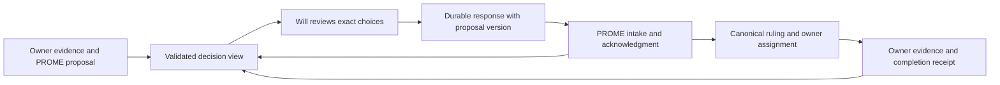

# Decisions — first design preview

**October 30, 2026.** Will authorized the mockup/workflow, liked the preview and subsequently selected desktop/laptop only; decisions, personal tasks and follow-through; and choices, defer and free-text requests for changes. This is a local, non-operational prototype. The subsequent [source-record draft](record-draft/README.md) and [three-copy comparison](comparison/README.md) are delivered for review. CATO owns these design artifacts. PROME's live authority and paused Decision Deck remain unchanged.

Open [index.html](index.html) in a browser. [Screenshot](preview.png) · [author-check receipt](validation.json) · [workflow investigation](../../runs/2026-10-30_1059_wq-decision-workflow.md).

## What to try

1. In **Decisions**, select an answer, add a condition and choose **Review response**. Cancel to keep editing or save a sample response.
2. Open **Clarify three research rules**. One part is already answered. Answer only one of the remaining parts; the other stays available without inheriting that answer.
3. Try **Ask a question or request changes** after writing a note. No approval is inferred. **Leave this for later** likewise makes no approval or decline.
4. Open **Tasks for me**. Reporting that a document was shared is different from approving research or the owner confirming receipt.
5. In **Follow-through**, distinguish a saved response, receipt by PROME and completed work. **History** keeps settled examples out of the decision inbox.
6. Search across all four views. Use **Reset preview** to restore the examples.

Every item is fictional and uses a DEMO identifier. No live queue, source file, account or private store is read. There are no network calls, local-storage writes, file uploads, model calls or agent launches. Response state exists only in this browser tab and disappears on reload. Closing the tab loses sample drafts. Desktop and narrow layouts were author-tested; actual phone use is untested.

## Product direction for discussion

Use a separate **Decisions** window with an entry from the existing launcher. A browser interface gives proposals room for comfortable reading, expandable original evidence and independently selectable choices. Begin with a local program that serves the interface and reads the workspace on the active computer. A desktop package is an optional later delivery choice, not a prerequisite for learning whether this workflow fits.

The useful first version is the complete path from a correctly presented proposal to a recorded response and an acknowledged result. A polished list alone would leave the main problem unresolved. Keep browsing and refresh mechanical; PROME contributes the recommendation and exercises judgment where an answer is ambiguous.

### Four views

| View | Meaning | Move out when |
|---|---|---|
| Decisions | An answer from Will is genuinely needed, including unresolved parts | Those parts are answered, explicitly deferred or returned for revision; nothing silently means approval |
| Tasks for me | A document, access or other action only Will can provide | Receipt/completion is established; a checkbox alone is not the owner's verification |
| Follow-through | A response is saved or a ruling has resulting work | Receipt, interpretation and owner delivery have reached their actual recorded disposition |
| History | Settled decisions and their full original terms | Retained for search; corrections/successors are linked, not presented as fresh approvals |

Deferred and question-pending items retain their specific unresolved status. They are not completed merely because they leave the main decision list. The mockup places them in Follow-through to demonstrate this; the final placement/filter language remains a usability choice.

### Reading and answering

Lead with the question, recommendation and consequences. Keep a material caveat visible; expansion is for depth, not a place to hide a qualification. Original proposal text and later corrections remain available. Display genuine dates with their meaning rather than converting every due date into urgency. HANDS reminder policy remains the existing one.

Use explicit choices for each decision part. Preserve option letters, text and consequences together. A free-text question or condition must not be reduced to a yes/no token. Provide one review step showing only the parts actually answered, the exact choice and the exact note. No bulk-approve-all control is proposed. In the mockup, question/defer acts concern the selected item; the subsequent record draft requires explicit unit scope for future responses. Revisit-date entry remains to be designed for live intake.

## Proposed workflow contract — not installed

### 1. Proposal production: one place to write the meaning

PROME retains WQ numbering and ruling integration; domain owners retain their evidence. The proposed structured record becomes the authored source for both the generated Markdown queue row and app view. PROME agreed this is necessary to avoid another separately maintained explainer. The [draft contract](record-draft/README.md) specifies a JSON block in an existing proposal/record and separate unit states. The current queue remains authoritative throughout the copy-based demonstration; changing that authority requires Will to see the comparison and approve bounded adoption.

The proposed description includes: WQ identifier; stable part identifiers; decision versus hands-task versus receipt classification; question and scope; option labels, text and consequences; recommendation; visible caveats; source references; dates and their meaning; owner; and a revision of the semantic content. The queue remains the live operator register. A deterministic reader/export should connect the two; it must report disagreement rather than choose the convenient copy.

Reuse existing readers and integrity checks where their contracts fit. The launcher already consumes PROME's versioned structured docket export (`spawn_list.open`) instead of inventing a new interpretation of its prose. That is a useful local precedent for a WQ export, but no equivalent complete WQ export was established by the investigation. It must cover independent parts, the successful empty-queue case, explicit read failures and live corrections. A ledger summary is insufficient for exact terms.

Legacy records that cannot be classified confidently should remain readable with a clear reason an answer cannot be submitted, pending owner clarification. Do not treat every OPEN row as an unanswered question or auto-upgrade old prose into actionable choices. No wholesale historical migration is proposed.

### 2. User response: durable and specific

A connected app would save a separate response event with a unique ID, decision/part IDs, the exact rendered choice and consequence, Will's unmodified note, timestamp, proposal revision and a reference to the complete displayed terms. Clarification, deferral, decline and approval are distinct actions. Keep the original event if Will changes his answer; a replacement links to the earlier one.

Before accepting a response, compare the displayed semantic revision with the currently available proposal. If materially changed, retain the draft and present the change for review. Do not reinterpret an old option label using a new proposal. A source read failure is not an empty decision list. A successful local write is labeled local; it is not a claim that another computer or PROME has it.

Notes that narrow or condition an approval remain attached to the permission. Until PROME acknowledges the intended scope, display the interpretation as pending rather than presenting an unconditional approval for execution.

### 3. PROME intake: acknowledgment is a separate artifact

Use PROME's normal intake at the next applicable working point rather than requiring a new PROME session for every click. The receiver checks response identity and duplication, source revision, part mapping, existing rulings and ambiguous conditions. An acknowledgment references the response event and canonical ruling/assignment. Repeated delivery of the same event must not create another ruling or commission.

The app may record answers while PROME is absent; it cannot promise immediate pickup. A conflicting or obsolete response is preserved and gets an explicit disposition. Any ambiguity with material consequences returns to Will. Completed work needs an owner result and the required verification, not only an acknowledgment.

No direct app overwrite of the live Markdown queue, automatic trade/agent execution or revival of the old hosted store is proposed. No arbitrary file saying “approved” should be accepted as a new Will ruling: the identity/trust boundary for app-originated responses must be part of the intake contract. File ownership, storage, authenticity and the user's local session model remain unresolved implementation details, not security claims proved by this mockup.

### 4. Cross-machine delivery

Distinguish **saved on this computer**, **available to PROME**, **acknowledged**, and **work completed**. Git continues to carry committed repository state through the existing serial desktop/laptop handoff. A local draft or unsent response is not synchronized by changing machines.

The production plan must specify the durable response store, who includes responses in authorized Git delivery (if Git is selected), any private-data boundary, receipts and failure recovery. The app must not pull/stash over other agents' work. Ordinary source refresh rereads files; it is not an automatic Git operation. Until delivery is verified, retain a visible pending state and a recoverable response. Offline reading can expose the last available snapshot with its age, never a claim of current remote state.

Will selected desktop/laptop only for the first version. Phone access is outside that scope; a narrower layout alone does not provide a reachable authenticated service or synchronization. No hosting, always-on receiver, notifications or recurring job is part of this prototype.

## Bounded implementation sequence after design review

1. **Confirm the interaction and source contract.** Will likes the mockup and has settled first-version device/view/response preferences. PROME's copies of 495, 551 and 552 and CATO's generated comparison are delivered. Review the shown conditions and remaining provenance/task-identity questions before moving source authority. Exit: Will has seen the three cases and a bounded live integration scope is settled.
2. **Implement the source reader/export.** PROME's producer contract and CATO's app reader agree on state and exact terms. Read-only production data first; uncertain legacy rows are explicit. Exit: representative simple, mixed, partial, settled, corrected, empty and unreadable cases display accurately without sends.
3. **Implement response persistence and intake together.** Choose storage, identity, ownership, delivery and acknowledgment. Exit: a test response survives restart, is accepted once, preserves conditions and produces a truthful receipt; stale/conflicting proposals cannot silently authorize different work.
4. **Verify the full path on both computers.** Cover interrupted saves, repeated delivery, simultaneous source edits and machine switching under the existing Git rules. Independent review applies to the consequential live integration under the relevant owner instructions. Exit: observed end-to-end behavior, plus explicit untested limits.
5. **Use it for ordinary decisions.** Begin with a few appropriate real decisions under the approved rollout scope. Check whether it reduces repeated explanations and whether PROME can consume responses without manual presentation upkeep. Expand only from that experience; no new timing study or recurring audit is implied.

The delivered scope now includes the mockup, workflow proposal, source-record schema draft and generated comparison of PROME's three pinned copies. Will's review and owner adoption conditions remain. No owner edits, authority transfer or live submissions have been activated.

## Author validation

Ten interaction checks passed at both 1440 × 1150 and 520 × 1100 in native Windows Chrome headless (twenty executions): initial state; cancel/draft preservation; navigation and literal text handling; partial decision scoping; final-part transition with pending receipt; clarification without approval; task completion without inferred receipt; cross-view search/empty results; confirmed reset; no page-width overflow. Desktop and narrow screenshots were visually inspected. Native phone hardware, assistive technology, production persistence, source parsing, real intake and cross-machine operation were not tested.

The harness used a temporary copy of this HTML with injected checks, isolated browser profiles and fictional inputs. It did not touch PROME records or existing browser sessions. [validation.json](validation.json) records the results and temporary evidence location; [preview.png](preview.png) is the retained desktop screenshot. These are author checks, not independent acceptance or demonstrated productivity gains.
