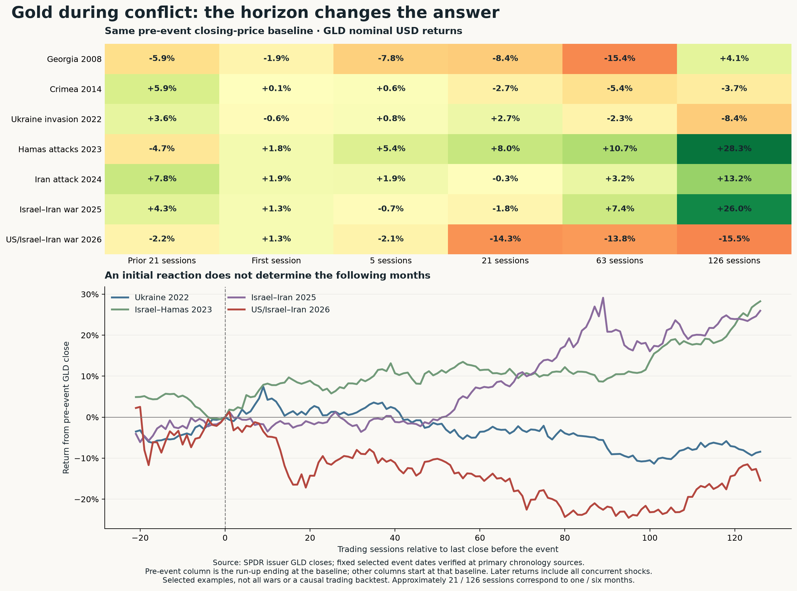

# How gold performs during war and geopolitical conflict

**MIDAS · October 25, 2026 · Will-directed historical follow-up.** Gold often attracts an initial bid when an unexpected conflict raises fear, but its performance over subsequent months varies widely. Conflict does not guarantee a sustained advance. The timing of the surprise, prior positioning and the monetary/liquidity environment matter. These are economic interpretations; the historical examples do not isolate a war-only causal return.

**Operator read:** gold can insure against an unexpected escalation, but owning gold for the entire duration of a war is a different proposition. If a war drives energy costs and interest-rate pressure higher, strengthens the dollar or forces investors to raise cash, gold can fall while fighting continues. The current weakness does not prove that gold never responds to conflict; it shows that a conflict thesis alone is insufficient for timing the holding.

[PDF](../sources/2026-10-25_war-history/gold_conflict_windows.pdf) · [SVG](../sources/2026-10-25_war-history/gold_conflict_windows.svg) · [method fixed before calculations](../sources/2026-10-25_war-history/METHOD.md).

## 1. Broader research supports a tendency, not a rule

The World Gold Council's **March 2, 2026** study examined **14 initial geopolitical-risk spike weeks**, January 1985–February 20, 2026, separated by at least eight weeks and selected using a two-standard-deviation threshold. Gold rose in **64%**. This includes geopolitical events beyond wars, is a small sample, and excludes the February 28 outbreak of the current Iran war. It is not a 64% forecast for the next conflict. [PRIMARY WGC](https://www.gold.org/goldhub/gold-focus/2026/03/weekly-markets-monitor-crisis-hedge).

A BIS-hosted October 2026 working paper uses **monthly January 1990–March 2026 data**. Its authors estimate positive average gold responses to geopolitical risks, stronger when financial conditions are loose. Their evidence favours investors' funding/rebalancing capacity over a separately identified opportunity-cost channel. It is model-based author research, not a BIS policy view or proof of every war's effect; its data end before the recent October selloff. [PRIMARY BIS paper](https://www.bis.org/publications/working-paper-1380-chasing-el-dorado-gold-under-shifting-geopolitical-and-financial-condition.pdf), especially data/methods and mechanism discussion. The regressions were read, not independently reproduced.

Together these support a useful distinction: fear can increase demand for gold, while financial conditions influence whether investors can and want to express that demand. Neither study establishes an automatic profit from buying gold after a war headline.

## 2. Modern conflict examples: same baseline, different outcomes

The fixed list below spans seven starts/escalations. **PRIMARY issuer GLD closing prices**, nominal USD/share after fund expenses, are the gold proxy. Baseline is the last observed close before the event; weekends use the first following fund-market session. “First session” is close-to-close, not the intraday high. Every later column uses the same baseline. No future price was used to choose the event date or decide which rows to retain.

| Conflict/start or escalation | Prior 21 sessions | First session | 5 sessions | 21 sessions | 63 sessions | 126 sessions |
|---|---:|---:|---:|---:|---:|---:|
| Georgia, Aug 8, 2008 | −5.86% | −1.93% | −7.82% | −8.40% | −15.44% | +4.10% |
| Crimea armed seizure, Feb 27, 2014 | +5.91% | +0.07% | +0.61% | −2.75% | −5.39% | −3.72% |
| Full-scale Ukraine invasion, Feb 24, 2022 | +3.64% | −0.65% | +0.81% | **+2.72%** | −2.33% | **−8.44%** |
| Hamas attacks / Israel–Hamas conflict, Oct 7, 2023 | −4.67% | +1.84% | +5.38% | **+8.04%** | +10.71% | **+28.27%** |
| Iran direct attack on Israel, Apr 13, 2024 | +7.80% | +1.87% | +1.91% | −0.29% | +3.20% | +13.18% |
| Israel–Iran war, Jun 13, 2025 | +4.25% | +1.31% | −0.66% | **−1.75%** | +7.44% | +25.96% |
| US/Israeli strikes on Iran, Feb 28, 2026 | −2.19% | **+1.29%** | −2.12% | **−14.30%** | −13.77% | **−15.47%** |

Twenty-one and 126 trading sessions approximate one and six months; exact endpoint dates are in the saved table. The 2026 one-year/252-session outcome is **not yet observed**. All later returns include policy decisions, currency moves, investor flows and other events. The 2008 example overlaps the financial crisis; 2014 was an escalation in a wider ongoing crisis; 2024/2025/2026 Middle East cases are related, not independent draws. No pooled “war probability” is inferred.

The full-scale Ukraine invasion illustrates why an intraday surge and a day's closing return can differ: GLD's first close was down despite the event, and its subsequent month was positive before the six-month return became negative. This does not dispute reports of an intraday gold spike; they measure another price and clock.

October 2023 shows that a conflict-era advance can persist. The later gain also overlaps a changing interest-rate/dollar environment and reserve/investor demand, so attributing the entire 28% to war would be wrong. June 2025 shows a positive first response, weaker first month and positive later periods. Current 2026 shows a positive first session followed by sharp losses. Gold's response depends on more than whether hostilities continue.

## 3. Older wars: monthly-average context, not an outbreak-day test

For older episodes we use the **PRIMARY World Bank Pink Sheet**, October 2, 2026 vintage, with London afternoon gold-fixing **monthly averages** in USD/troy ounce for these dates. Each ratio compares the named later month's average with the average of the month **before** the conflict. These are not investable daily endpoint returns and are not pooled with GLD.

| Conflict/stage | Pre-event baseline month | Event-month average change | Month +3 versus baseline | Month +6 | Month +12 |
|---|---|---:|---:|---:|---:|
| Arab–Israeli war, Oct 1973 | Sep 1973 | −2.91% | **+25.24%** | **+66.99%** | +54.37% |
| Soviet invasion of Afghanistan, Dec 1979 | Nov 1979 | **+16.07%** | +41.33% | +53.32% | +37.25% |
| Iraq invades Kuwait, Aug 1990 | Jul 1990 | **+8.81%** | +5.23% | **+0.27%** | −1.93% |
| Coalition Gulf War campaign, Jan 1991 | Dec 1990 | +1.86% | **−5.04%** | −2.39% | −6.10% |
| Iraq invasion, Mar 2003 | Feb 2003 | **−5.01%** | −0.84% | +5.57% | +13.37% |

The 1970s also included oil inflation, currency-system change and monetary instability, so these large moves cannot be assigned entirely to fighting. December 1979's invasion occurred late in the month, limiting event-month inference. The 1990 and 1991 rows are stages of the same conflict; buying before one stage and after another produces a different result.

A contemporary 2003 LBMA article by a Macquarie analyst describes gold rallying before military activity, then long liquidation as a short campaign became expected. It also describes post-1991 price softening. This is a dated market interpretation, not an experimentally identified war premium. [PRIMARY contemporary LBMA publication](https://www.lbma.org.uk/alchemist/issue-30/not-just-another-war-story).

World War I/II nominal USD gold prices are poor direct comparators because the monetary and ownership/trading regimes differed. Under Bretton Woods, dollars were convertible into gold at a fixed official price until the US ended convertibility in August 1971. A fixed official price is not evidence that freely traded gold would ignore war. [Federal Reserve History](https://www.federalreservehistory.org/essays/gold-convertibility-ends).

## 4. The patterns useful to the operator

| Question | Historical implication |
|---|---|
| Was the event unexpected, or had investors already positioned for it? | The prior rise may have captured part of the risk before the outbreak. A positive response is possible, not assured. |
| Did the event expand uncertainty or resolve a feared outcome? | Gold can rise on fear and weaken when investors judge the outcome more contained; this is an interpretation, not a measured universal rule. |
| Did energy inflation lead to higher expected rates, real yields or a stronger dollar? | Those channels can offset demand for a perceived haven. The existing gold/rate association does not by itself identify each war's effect. |
| Are investors protecting wealth or raising cash? | Cash/liquidity pressure can produce gold sales during a crisis. Positive longer-horizon diversification need not provide a positive first-week payoff. |
| Is the position held for days or years? | Those are different questions. Conflict alone supplies no reliable duration, entry, target or recovery clock. |

**Current read:** the 2026 decline is compatible with gold having responded initially to the war and subsequently facing stronger offsetting forces. It does not prove a permanent loss of haven status, nor does continuing conflict establish an imminent rebound. To strengthen the near-term haven case, gold needs to demonstrate a sustained positive response to renewed uncertainty, alongside stabilising investment holdings and supportive rate/dollar conditions. Those are evidence directions, not new thresholds or registered forecasts.

## Sources, boundaries and validation

The selected events' primary chronology sources and exact market endpoints are embedded in `daily_conflict_event_returns.csv`. Modern chronology was checked at UN/OHCHR, the UK Parliament library and the UN's June 2025/February 2026 accounts; Georgia is a named escalation, not a responsibility adjudication. Older chronology uses the US Office of the Historian pages linked in `manifest.json`; those archival history pages are no longer maintained, which does not make their past-event dates current-news evidence.

Raw source captures, hashes, calculations, paths, monthly comparisons and charts are in `../sources/2026-10-25_war-history/`. The World Bank workbook's additional mismatch sheet was inspected: **zero gold entries**. No repair or alteration of publisher history was made. The current WB description changes its gold benchmark from June 2025; only pre-2004 monthly observations are used here, before that change. Daily GLD and monthly gold averages remain separate.

No confidence interval, independent-war sample, causal attribution or trading edge is claimed from these selected examples. No score, numerical band, frozen prediction, position or standing cadence changed. Actual composite remains 8/20; existing certified-settlement and scheduled-release obligations remain separate.
