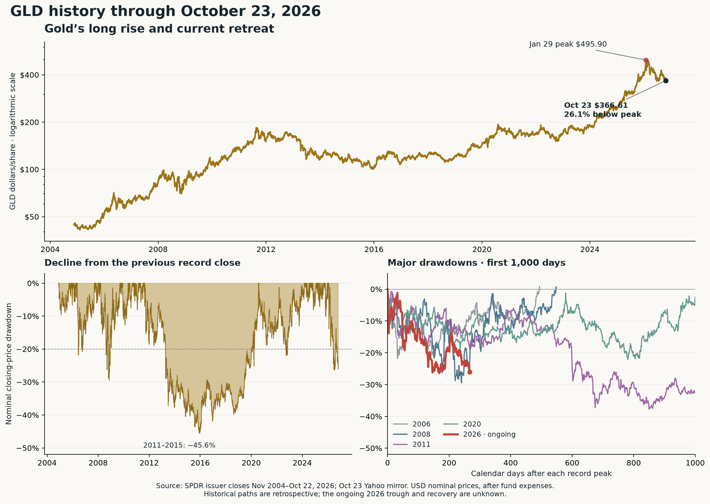

# Recent gold performance versus its own history

**MIDAS · October 25, 2026 · Will-directed research.** Endpoint October 23 completed close. The reproducible comparison uses GLD, the US gold ETF, in nominal dollars per share after fund expenses. PRIMARY issuer history begins November 18, 2004 and currently ends October 22, 2026; Friday October 23 is one labelled Yahoo MIRROR extension, **$366.61**. The 453 overlapping issuer/vendor dates agree within $0.000015. No futures roll or certified-settlement substitution enters the comparison.

**Judgment:** this is a substantial correction after an exceptional rise, with price action weak enough to take seriously. The historical record supports both a cyclical recovery and a prolonged bear market. It does not show that a 26% decline makes gold cheap or close to a bottom. Investor holdings have been more resilient than in the long 2011–2015 decline, but gold's failure to respond to recent falling real yields weakens the near-term rebound case. No score, frozen forecast, position or numerical trigger changed.

[PDF chart](../sources/2026-10-25_historical-comparison/gold_historical_comparison.pdf) · [SVG chart](../sources/2026-10-25_historical-comparison/gold_historical_comparison.svg) · [fixed calculation method](../sources/2026-10-25_historical-comparison/METHOD.md).

## 1. Recent weakness is real; the long rally also survives

| Window ending Oct 23 | GLD change | Historical context, endpoints before 2026 |
|---|---:|---|
| 5 trading sessions, Oct 16→23 | **−4.03%** | 3.9 th percentile of 5,307 rolling five-session returns |
| 21 sessions, Sept 24→Oct 23 | **−6.40%** | 5.2 nd percentile of 5,291 rolling returns |
| 63 sessions, July 27→Oct 23 | −2.14% | 27.9 th percentile of 5,249 rolling returns |
| 126 sessions, Apr 24→Oct 23 | **−15.38%** | 2.7 th percentile of 5,186 rolling returns |
| 252 sessions, Oct 22, 2025→Oct 23, 2026 | −2.83% | 24.4 th percentile of 5,060 rolling returns |
| 504 sessions, approximately two years | **+45.90%** | 76.3 rd percentile of 4,808 rolling returns |
| 756 sessions, approximately three years | **+102.69%** | 93.9 th percentile of 4,556 rolling returns |

The historical percentile describes overlapping observations; it is not a probability of a subsequent bounce. Windows use actual trading observations, not fixed calendar years. GLD is down **7.49% year to date**, following **+63.68% in 2025**, +26.66% in 2024 and +12.69% in 2023. January 2026 alone, through the January 29 peak, added **25.13%** from December 31.

From the **September 26, 2022 GLD low $151.23**, gold rose **227.91%** to January 29, 2026's **$495.90** peak. Even after the current fall, it is still **142.42% above that low**. This reconciles the apparently conflicting observations: gold has been a poor recent holding and a very strong multiyear holding.

The current close is **26.07% below the January record**. The lowest close so far in this ongoing episode was **July 16 $364.96**, a **26.40% drawdown**. Friday is only **0.45% above that low**, after giving back 10.24% since August 31. This is a return toward an existing low, not the first time the episode has fallen 25%. The first 25% closing-price crossing occurred June 24. Returning to the January high from Friday would require **+35.27%**; a 26% loss and 26% subsequent gain do not cancel.

## 2. Comparable major declines had very different recoveries

An episode starts at a record GLD closing price and ends when that same record is regained. It does not restart after every bounce. All five episodes in this dataset reaching 20% are shown; four are complete,2026 is ongoing.

| Record peak | Trough or low so far | Deepest decline | Prior high regained | Total calendar time below prior high |
|---|---|---:|---|---:|
| May 12, 2006 | June 14, 2006 | −21.79% | Sept 18, 2007 | 494 days / 1.35 years |
| Mar 17, 2008 | Nov 12, 2008 | −29.45% | Sept 16, 2009 | 548 days / 1.50 years |
| Aug 22, 2011 | Dec 17, 2015 | **−45.56%** | July 29, 2020 | **3,264 days / 8.94 years** |
| Aug 6, 2020 | Sept 26, 2022 | −22.00% | Mar 4, 2024 | 1,306 days / 3.58 years |
| Jan 29, 2026 | July 16 low so far | −26.40%; **−26.07% currently** | **Unknown** | 267 days elapsed; still open |

Today's decline is deeper than the 2006 and 2020–2022 episodes, but shallower than 2008 and 2011–2015. Calling it an ordinary small dip would understate it. Calling it proof of a permanent collapse would also outrun the evidence. The 2011 peak required almost nine years to regain in nominal GLD terms; recovering purchasing power would be a separate, inflation-adjusted question.

There are only **two completed prior episodes** that crossed 25% on this daily-record definition. A year after the first crossing, GLD was **+31.64% after September 10, 2008**, and **−2.63% after April 15, 2013**. These start on first-crossing dates, not eventual troughs. They are too few, too different and too loosely matched in economic conditions to turn into a probability, trading edge or current recovery deadline. Four historical 20% episodes likewise do not establish a robust recovery distribution.

Definitions matter. The [World Gold Council's July 2025 historical review](https://www.gold.org/goldhub/research/whats-a-bear-case-for-gold) examines monthly spot-price runs since 1971, rather than daily GLD record drawdowns. Its 1974–1976 example shows that a large correction can occur inside a longer gold bull era; its discussion highlights rates, the dollar, investment demand and shifting risk appetite. Those older spot figures are context, not additional observations in the GLD table. Its monthly opportunity-cost proxy also differs from today's market-implied TIPS real yield. No pre 2004 recovery path was spliced into this calculation.

## 3. The mechanism matters more than resemblance of the chart

**Real-rate sensitivity is historically familiar.** A gold holding pays no interest, so higher inflation-adjusted Treasury yields can make the competing bond holding more attractive. Daily percentage changes in GLD and same-endpoint changes in the 10-year real yield have a negative association across every historical era measured here:

| Period | Observed endpoint pairs | GLD association with +10 bp real-yield change | Daily variation associated with one-factor fit |
|---|---:|---:|---:|
| 2010–2015 | 1,498 | −0.60% | 6.5% |
| 2016–2019 | 999 | −1.14% | 23.6% |
| 2020–2022 | 750 | −0.72% | 18.9% |
| 2023–2025 | 747 | −0.57% | 8.1% |
| 2026 through Oct 22 | 202 | −1.31% | 6.8% |
| Last 120 pairs through Oct 22 | 120 | −1.18% | 10.2% |

These are associations, not yield forecasts, causal shares or price targets. FRED history is saved latest-revised MIRROR data; primary Treasury observations supply the newer 2026 values. Actual observed endpoints are joined without forward-filling. Missing yield-publication days mean some pairs span more than one trading session. Most daily movement remains outside this single-factor fit.

The last 120-pair coefficient here is a **new descriptive estimate on issuer prices/matched primary Treasury 2026 observations**. It does not replace WQ-451/MIDAS-17's frozen−0.1526%/bp coefficient through October 16. On this review's input construction, theOctober 16 estimate is−0.1513, close but not exactly identical to the earlier vendor/FRED-based fit; source/calendar choices and endpoint changes are retained rather than silently fused.

**The current warning is the response to relief.** From October 9→22 the primary 10-year real yield fell **2.91%→2.64%, or 27 bp**, while issuer GLD fell **$384.58→$369.00, or 4.05%**. Lower yields should have relieved one headwind; the price still declined. That establishes weak response, not the exact cause. The measured October 22 liquidation case and bullion withdrawal supply additional evidence of selling pressure. It does not justify declaring every day a forced liquidation.

## 4. Investor holdings distinguish this episode from past ones

Reported GLD bullion quantity is separate from its dollar asset value. A fall in fund value can reflect a lower gold price without withdrawals. These quantities come from the same PRIMARY issuer workbook:

| Price episode endpoints | Change in GLD bullion | Percent change in bullion |
|---|---:|---:|
| Mar 17→Nov 12, 2008 | +85.11 t | **+12.82%** |
| Aug 22, 2011→Dec 17, 2015 | −654.23 t | **−50.94%** |
| Aug 6, 2020→Sept 26, 2022 | −324.49 t | **−25.59%** |
| Jan 29→Oct 22, 2026 | −40.89 t | **−3.76%** |

The smaller 2026 holdings contraction means this fund has not shown the same broad holder exit seen across 2011–2015. It does not prove all investors or all central banks are buying, and the historical periods have different lengths. In 2008, holdings grew while gold fell almost 30%, demonstrating that even increasing fund quantities do not guarantee a price floor.

The immediate contrary evidence is **−11.98 t onOctober 22**, a single large withdrawal within a much smaller year-to-date holdings decline. Yet October 22's 1,045.64 t is still 43.76 t above July 16's 1,001.88 t, while price is back near July's low. Net reported quantities include fund operating/fee effects and are not gross subscription/redemption flows. The issuer archive has noOctober 23 row, so Friday's flow is unknown.

The already-saved WQ-451 stress study also matters: GLD rose on **2 of 12** defined equity-stress days in its last 120-session sample. A March 9→19,2020 illustrative stress window saw GLD fall 12.53% too. Gold can be sold for cash during an initial panic. Neither selected stress window defines a recovery clock. The sample concerns equity declines; **hedge value for a bearish-option book remains unestablished**.

## Practical read

The longer-run bull case has survived corrections this large before. Today's relatively resilient GLD bullion holdings give less evidence of a broad investor exit than 2011–2015, but they have not prevented price losses. A rebound case becomes more persuasive when gold actually strengthens during stable/falling real yields and when bullion holdings stop deteriorating. Continued weakness despite that rate relief, followed by sustained holdings losses, would make the longer bear-market comparison more relevant. Those are evidence directions, not newly adopted trigger rules.

**Working assessment: substantial correction of an exceptional multiyear advance; near-term weakness remains unrefuted.** Historical comparisons support patience about the long-run story and caution about declaring an immediate bargain. The missing certified gold settlement remains a separate scoring issue; none of the percentage-history analysis depends on grading the$4,050 futures boundary.

Source/reproducibility: [issuer fund page and archive access](https://www.spdrgoldshares.com/usa/gld/); same-day captured issuer workbook and labelled Yahoo mirror extension in the prior boot bundle; [method and source hashes](../sources/2026-10-25_historical-comparison/summary.json), [calculation](../sources/2026-10-25_historical-comparison/calculate.py), and all CSV outputs in that directory.205 issuer holiday/non-numeric rows are excluded explicitly; no zero prices or forward-filled market closes. Supplementary holdings/event-window context was inspected after the initial drawdown computation, and was not a preregistered signal or test. No standing monitor or forward forecast was created.
