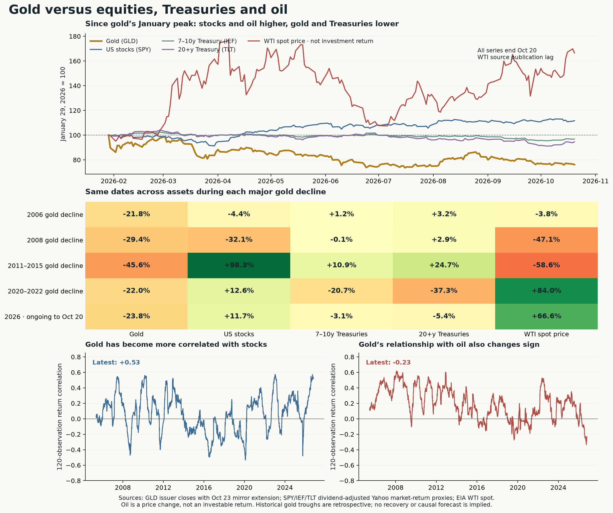

# Gold versus equities, Treasuries and oil

**MIDAS · October 25, 2026 · Will-directed extension of today's gold-history study.** The central finding is a change in the relationships: gold has recently moved much more closely with equities, while its relationship with oil has turned negative. Gold's current decline shares the directional pattern of the 2020–2022 gold retreat—stocks up, Treasuries down, oil up—but that resemblance is descriptive, not a causal diagnosis or a recovery forecast.

**Practical implication:** gold is currently providing less protection against equity declines than its long-run diversification reputation would suggest. Treasuries have participated in the recent defensive bid while gold has not. An oil price rise alone does not establish a gold tailwind. This does not establish the hedge value of gold for a bearish-option book, which remains unmeasured.

[PDF chart](../sources/2026-10-25_gold-cross-assets/gold_cross_assets.pdf) · [SVG chart](../sources/2026-10-25_gold-cross-assets/gold_cross_assets.svg) · [method fixed before retrieval/calculation](../sources/2026-10-25_gold-cross-assets/METHOD.md).

## What is being compared

| Asset | Instrument and basis | Source and endpoint |
|---|---|---|
| Gold | GLD closing price, fund expenses embedded; no cash distributions | PRIMARY issuer to October 22; one labelled Yahoo MIRROR October 23 extension, as in previous study |
| US equities | SPY, S&P 500 large-cap US stocks; dividend-adjusted market-return proxy | Yahoo MIRROR explicit Adj Close, October 23 |
| Intermediate Treasuries | IEF, 7–10 year US Treasury bonds; distribution-adjusted market-return proxy | Yahoo MIRROR explicit Adj Close, October 23 |
| Long Treasuries | TLT, 20+ year US Treasury bonds; distribution-adjusted market-return proxy | Yahoo MIRROR explicit Adj Close, October 23 |
| Oil | EIA Cushing WTI physical spot dollars/barrel; price change only | PRIMARY EIA historical XLS captured today, latest observation October 20, **$107.89/barrel** |

Oil's publication lag means **all-asset comparisons end October 20**, while fund-only comparisons extend to October 23. All rows use identical actual start/end dates across their columns. No oil value is forward-filled to Friday. WTI spot is not a commodity investment return, continuous futures settlement, Brent price or USO return. These Treasury funds are not corporate bonds or a complete bond-market benchmark.

ETF returns include the provider's distribution adjustments. We captured raw Close, Adj Close and cash distributions separately and found no splits. IEF/TLT annual 2022 and 2025 returns reconcile with issuer market-return disclosures within **0.016 percentage points**; SPY through September 30, 2026 differs from issuer Market Value YTD by **0.049 percentage points**. The issuer uses its own market quote convention; no exact NAV/close identity is claimed. Sources: [SPY issuer](https://www.ssga.com/us/en/individual/etfs/state-street-spdr-sp-500-etf-trust-spy), [IEF issuer](https://www.ishares.com/us/products/239456/ishares-710-year-treasury-bond-etf), [TLT issuer](https://www.ishares.com/us/products/239454/ishares-20-year-treasury-bond-etf), [EIA WTI history](https://www.eia.gov/dnav/pet/hist/RWTCD.htm).

## 1. Current cross-asset picture

**January 29 gold record → October 20, latest common oil/fund date:**

| Gold | US stocks | 7–10y Treasuries | 20+y Treasuries | WTI spot price |
|---:|---:|---:|---:|---:|
| **−23.85%** | **+11.67%** | −3.14% | −5.36% | **+66.57%** |

**2026 YTD → October 20:** gold −4.71%, stocks +13.66%, IEF −3.30%, TLT −4.86%, WTI spot +88.42%. Gold's peak-to-date decline and YTD return answer different questions: January's gain was large before the peak.

**The newer fund-only evidence is weaker for gold:**

| Matched window | Gold | US stocks | IEF | TLT |
|---|---:|---:|---:|---:|
| October 16→23, five sessions | **−4.03%** | −0.43% | +0.70% | +1.61% |
| September 24→October 23, 21 sessions | **−6.40%** | −0.94% | +1.87% | +2.83% |
| October 9→22, real-yield relief | **−4.05%** | −1.88% | **+2.01%** | **+4.82%** |
| October 21→22, liquidation day | **−2.63%** | −1.18% | +1.07% | +1.87% |

The prior study measured a **27 bp real-yield decline October 9→22**. This comparison now shows where defensive strength appeared: Treasury funds gained while gold declined. That establishes relative weakness, not the identity or motive of every seller. Friday October 23 further lowered gold to $366.61; Friday YTD is −7.49% and drawdown from January is −26.07%, versus stocks +12.32% YTD, IEF −2.44% and TLT −3.42%. Oil has no matched Friday observation in the held primary vintage.

## 2. What happened during the same historical gold declines?

Each historical row uses the **gold record peak and eventual gold trough dates**, exactly as identified in the preceding study. Other assets' own peaks/troughs are not substituted.

| Gold decline window | Gold | US stocks | IEF | TLT | WTI spot |
|---|---:|---:|---:|---:|---:|
| May 12→June 14, 2006 | −21.79% | −4.44% | +1.22% | +3.24% | −3.83% |
| March 17→November 12, 2008 | −29.45% | −32.05% | −0.09% | +2.85% | −47.09% |
| August 22, 2011→December 17, 2015 | **−45.56%** | **+98.29%** | +10.91% | +24.66% | **−58.56%** |
| August 6, 2020→September 26, 2022 | **−22.00%** | **+12.62%** | **−20.73%** | **−37.26%** | **+84.04%** |
| January 29→October 20, 2026, ongoing | **−23.85%** | **+11.67%** | **−3.14%** | **−5.36%** | **+66.57%** |

Of these named episodes, the **2020–2022 row shares today's sign pattern in every column**. The bond losses then were much larger and the period was much longer. In contrast, the 2011–2015 decline accompanied positive Treasury returns and falling oil prices. The 2008 gold drawdown overlapped severe equity and oil losses. This helps distinguish competing narratives but cannot establish a nearest-neighbour forecast, causal mechanism, further downside or recovery date. Endpoints are retrospective, and there are only four completed major gold drawdowns in this ETF sample.

## 3. Daily and full-year crisis outcomes can differ

| Fixed calendar case | Gold | US stocks | IEF | TLT | WTI spot |
|---|---:|---:|---:|---:|---:|
| 2008 full year | **+4.92%** | −36.80% | +17.92% | +33.95% | −53.52% |
| March 9→19, 2020 cash liquidation | **−12.53%** | −12.30% | −4.36% | −13.43% | −19.19% |
| 2020 full year | **+24.81%** | +18.33% | +10.01% | +18.15% | −20.92% |
| 2022 full year | **−0.77%** | −18.18% | −15.16% | −31.23% | +6.41% |
| 2023–2025 combined | **+133.62%** | +85.50% | +11.26% | −1.50% | −28.57% |

Gold could fall sharply during a cash scramble and still finish the broader crisis period ahead. It was also a useful **relative** cushion in 2022 despite a small absolute USD loss. Full-year oil returns can hide a large intrayear spike. This is why “gold hedges crisis/inflation” needs a named horizon and why a negative day or month alone cannot settle the strategic argument.

The [World Gold Council diversification review](https://www.gold.org/goldhub/research/relevance-of-gold-as-a-strategic-asset/diversification) uses different spot/index instruments, weekly tail conditioning and selected longer crisis windows. Its evidence of crisis diversification is not an assertion that gold rises every day equities fall. Our daily GLD/SPY tests below neither reproduce nor overturn that distinct study.

## 4. Historically gold has had little average equity or oil correlation

Correlation measures how returns move together, from −1 to +1. It does not measure relative performance, causality or the size of a portfolio hedge.

**Completed common-endpoint monthly returns, December 2004→September 2026, 262 observations:**

| Gold versus | Full-period monthly correlation |
|---|---:|
| US stocks | **+0.09** |
| IEF | **+0.32** |
| TLT | **+0.24** |
| WTI spot | **+0.07** |

The modest positive Treasury association is consistent with gold and bonds sometimes benefiting together when yields fall. The near-zero equity/oil averages mean no stable one-for-one link, not a dependable inverse relation. Relationships change materially across eras: monthly gold/oil correlation was **+0.41 in 2004–2007**, versus **−0.28 in 2023–2025**. All full-history averages can conceal the regime that matters today.

**Daily observed-pair relationships:**

| Gold versus | Pre-2026 correlation | 2026 correlation | Latest 120 observations |
|---|---:|---:|---:|
| US stocks | **+0.05** | **+0.39** | **+0.53** |
| IEF | +0.21 | +0.28 | +0.35 |
| TLT | +0.16 | +0.16 | +0.24 |
| WTI spot | +0.17 | **−0.12** | **−0.23** |

Fund pairs run through October 23; oil pairs through October 20. The latest fund window starts May 5; the latest oil window starts April 30. Oil holidays/missing reports can make an observed endpoint pair span more than one stock-market session. Pre-2026 fund samples contain 5,311 pairs, current year 204; oil 5,160 and 201, respectively. The main monthly table avoids mixing these differing daily frontiers.

An **exploratory robustness check**, run after the prespecified results, gives gold/stocks rank correlation **+0.49**, and ordinary correlation **+0.50** after removing the five largest absolute gold moves from the recent 120. The positive relationship is therefore not solely the result of one extreme day. These checks establish no forecast or permanent regime change. There are only nine completed 2026 months, so monthly estimates for this year are especially unstable.

## 5. Has gold actually risen when the other assets fell?

This is a new, explicit **SPY down at least 1%** daily sample, distinct from WQ-451's S&P/VIX definition:

| Sample | Stock-stress days | Gold rose | Average gold return | Average IEF / TLT return |
|---|---:|---:|---:|---:|
| November 2004–2025 | 644 | **47.7%** | **−0.06%** | +0.26% / +0.54% |
| 2026 through October 23 | 20 | **25.0%** | **−1.33%** | −0.13% / −0.21% |

Gold historically offered low average co-movement rather than a guarantee of a positive equity-down-day payoff. Its 2026 outcomes in this sample have been weaker. Current-year counts remain small and do not create calibrated future probabilities.

On days **both SPY and IEF fell**, gold rose on **41.8% of 905 pre-2026 observations**, averaging −0.20%; in 2026 it rose on **29.9% of 67**, averaging −1.05%. In the tighter, descriptive sensitivity bin where each fell at least 0.5%, gold was down on all **8** current-year observations. That is a small observed count, not a “zero chance” claim. Gold is not established here as protection against every simultaneous stock/bond decline, or against a bearish-option book's losses. No allocation/backtest was performed.

## 6. Oil up does not automatically mean gold up

Before 2026 there were **28 completed common-endpoint months with WTI up at least 10%**. Gold averaged +1.46% and rose in 60.7% of those months; stocks averaged +2.98%, so this bin includes recovery/demand episodes as well as supply shocks. IEF averaged −0.09% and TLT −0.45%.

In the **four** such completed months of 2026, gold averaged **−1.17%**, stocks −0.94%, IEF −1.82% and TLT −3.53%. Gold rose in two of the four; both Treasury funds fell in all four. The bin is a fixed descriptive cut, not an adopted trigger. These samples do not identify whether supply, demand, inflation expectations, real yields, the dollar or positioning caused the movements. They do show why an oil-up/gold-up rule is unreliable.

The mechanical percentage-return problem around **April 20, 2020 WTI −$36.98** is retained in raw data. Two adjacent daily oil return observations, April 20 and 21, are excluded because one endpoint is nonpositive; no ordinary percentage-return hedge inference is made from them. Completed monthly endpoints remain positive. Oil's extreme rebound months also limit the interpretation of simple conditional means.

## What this adds to the gold thesis

The evidence favours separating three questions:

1. **Longer-run diversification:** gold's low average stock/oil correlation and distinct performance across full economic cycles remain evident. Over the same November 18, 2004→October 20, 2026 interval, $100 became approximately **$851 in GLD, $967 in SPY, $191 in IEF and $185 in TLT** on these fund return proxies. This is one start/end period, after fund expenses but before taxes/costs, not a ranking valid for every horizon.
2. **Current defensive behaviour:** recently gold has been more equity-like and has failed to join the Treasury rally. That weakens the immediate haven case, without deciding the strategic case or bearish-option hedge question.
3. **Oil-shock transmission:** higher oil is compatible with weaker gold when other channels offset the inflation narrative. The current sign pattern resembles 2020–2022, but the decline's cause and future path require separate evidence.

No trade, score, band, probability, frozen prediction or research cadence changes. Actual composite remains 8/20. The certified-settlement problem at the existing gold futures boundary remains separate; this comparison uses dated fund returns and EIA physical spot, not an unverified futures grade.

Reproducibility: `../sources/2026-10-25_gold-cross-assets/` contains captured source timestamps/hashes, raw ETF histories, EIA XLS/HTML, issuer pages, source/return checks, common panels, all tables, oil exclusions, calculation and inspected charts. The prior gold-history source manifest remains canonical for GLD. Bond curve/gate judgments and current oil supply/contract judgments remain with their domain owners; only informational result packets are routed, with no new assignment.
