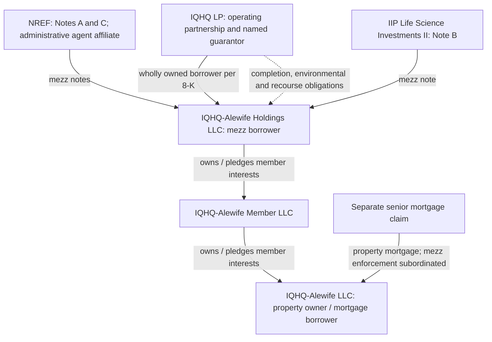

# IQHQ funding durability — funded cash, future uses and recourse

**Authority:** Will directly, October 12: “Okay I would like us to complete all three of this research.” Leg 1 of the three questions in `2026-10-12_NEXT_HIGH_SIGNAL_QUESTIONS.md`. Existing OZK/Codex window, no delegation. This completes the bounded public-document map; it does not certify project cash runway or sponsor solvency.

**Conclusion:** Alewife has actual refinancing and committed completion funding, with contractual interest financing and lender controls. Its $245 million IIPR commitment is not $245 million of unrestricted new construction cash. We cannot establish a cash-flow deficit or sufficient runway without the omitted revised budget, current loan draws, cash rent and sponsor liquidity. The strongest positive evidence remains an executed funded advance and tenant-linked work; the useful risk mechanism is depletion of conditional commitments by interest, fees and completion costs. This does not identify RaDD's new capital provider or measure OZK loss.

## Disclosed sources and uses — September 28 closing basis, $ millions

| Claim/funding | Disclosed amount | Economic use and limit | Primary locator |
|---|---:|---|---|
| Existing mezzanine Note A / co-lender A-1 | 133.0 fully funded in initial commitment schedule | Existing debt, not new September cash. No further A-1 advance obligation | Co-lender Exhibit C; §7.1(a) |
| New IIPR Note B / co-lender A-2 | 245.0 maximum; approximately 111.0 initially advanced | Initial advance repays the old bridge plus accrued interest, fees, minimum return and other amounts. No disclosed split identifies construction cash from this advance | October 1 8-K Item 1.01; Sixth §3(a) |
| Retired bridge | 85.0 principal | Refinanced, not $85 million remaining alongside the new debt. Payoff other amounts cannot be allocated from an unavailable payoff letter | Same |
| Note B still to fund | Approximately 134.0 = 245.0 − 111.0 | Gross conditional capacity expected through Q4 2027; available for tenant/landlord/amenity work, debt service and expenses under conditions. **Not a net TI budget or cash on hand** | Issuer release; 8-K Item 1.01 |
| New NREF Note C / co-lender A-3 | 22.0 maximum; actual closing draw undisclosed here | Pays extension fee, interest on A/C, share of mortgage interest and costs. Do not assume it is wholly undrawn after closing | Sixth §3(d)/(j); co-lender §7.1 |
| Total mezz maximum | 400.0 = 133.0 + 245.0 + 22.0 | Commitment, not closing cash or outstanding principal | Sixth recitals; 8-K |
| Separate senior mortgage | 85.0 original maximum after September 2025 bifurcation | Property-level debt; original maximum does not verify current balance or current senior lender identity | Newly obtained base agreement recitals, printed p.1; 8-K |
| Origination and underwriting fees | 0.5% each of 267.0; **2.67 combined, derived** | Contractual fees drawn against new notes. Do not add this amount to 111.0 or subtract it again without a reconciled draw schedule; funding overlap is unknown | Sixth §3(b)–(d) |

The co-lender Exhibit C lists A-2/A-3 funded commitments at zero and their full commitments as unfunded. It is an **initial schedule**, not a post-closing cash snapshot; the dated issuer disclosure establishes approximately $111 million subsequently funded at closing. A minimum identified mezz principal of approximately $244 million (133 + 111) is a closing-based inference before unknown C draws/other allocations, not a certified outstanding balance today.

## Entity and claim map

Source: base agreement recitals/definitions; 8-K Item 1.01; Sixth §§19–20. The executed senior intercreditor agreement and separate guaranty instruments were not furnished in the source set read. Do not substitute a corporate blanket guarantee or assume all campuses are cross-defaulted. The co-lender agreement requires unanimous consent to newly cross-default this loan with another loan (§2.2(b)(ii)); that clause does not certify the absence of every existing cross-default elsewhere.

## What consumes capacity, and what protects it

| Mechanism | Verified contract / limit | Consequence |
|---|---|---|
| Interest can be financed | Sixth §3(j), co-lender §7.1(c): B funds B interest; C funds A/C interest; B/C share mortgage interest funding. Base §2.22(e) conditions include available unallocated funds/no continuing default | Interest receipt at a lender need not demonstrate tenant-funded debt service. No actual draw/payment history was disclosed; this is contractual permission, not an observed default |
| Reserve substitution | Sixth §3(f)/(g): reserves due by February 28, 2027; qualifying estimated operating income can offset certain reserves; sufficient unfunded proceeds may be reserved for debt service instead of a separate debt-service deposit | Financing can cover time to rent commencement. Need actual reserved amounts and remaining work budget to test runway; no new standalone monitoring mandate |
| Completion and draw controls | Base §§2.25/2.30: projected costs versus permitted funding, cure/reallocation/cash collateral; lenders need not continue advancing through an uncured deficiency. Sixth §§3(k)/(s)/(t), co-lender §2.2(f)/§7.1: construction/tenant documents and lender consent for relevant waivers | Committed capital is conditional, but conditions protect lenders; satisfying them creates a funding obligation subject to applicable defaulting-lender provisions, not mere lender discretion |
| Second extension test changed | Sixth §3(h): maximum aggregate as-is LTV **60%→75%**, replaces old second-extension DSCR test with **6.75% maturity-extension debt yield**, with permitted prepayment/collateral alternatives | Terms permit more leverage at that later test. Definition includes contractual rent from tenants **in occupancy**, notwithstanding rent abatement/free rent. It is not a current cash DSCR and not rent from unoccupied space |
| Sponsor recourse differs by note | Sixth §19(f): Carry Guaranty applies only to non-IIP obligations. Completion, environmental and recourse obligations are separately described by issuer | Cannot assume IIP has the same carry protection as NREF, or infer no sponsor support at all. Full guarantees and guarantor current liquidity remain unread/unavailable |
| Shared mezz payment priority | Co-lender §§4.1–4.3/5.1: ordinary notes share priority, subject to expense/protective-advance/fee waterfall and repayment shares; losses from specified workouts shared | A/B/C letters are not three seniority tranches. Protective advances and fees can change dollars reaching each ordinary note. Senior mortgage remains a different claim |
| Exit route | Newly obtained Alewife ROFO side letter §§1–2: purchase/refinancing right of first offer with process and lender-consent limits; 8-K describes effectiveness linked to $155 million Note B funding | A right to offer is not an executed purchase, committed refinance or cash exit. No evidence that effectiveness threshold is reached today |

**Counterevidence:** Sponsor invested capital, a tenant-linked financing purpose, actual bridge payoff, completion guarantees, cost-deficiency controls and conditional draw obligations are real protections. Financing interest during completion is not intrinsically evidence of impairment. We have no basis to deny these protections or label the transaction a failed rescue.

## Sponsor-wide holdings are separate measurement objects

| Holder/source vintage | Disclosed IQHQ claim | Measurement limit |
|---|---|---|
| IIPR October presentation p.8 | $100 million revolving credit investment + $170 million preferred; issuer says fully funded as of June 2026 | Different claims from new Alewife Note B; disclosed yields 13.5%/15.0% are not verified cash-payment performance. New-to-this-map reuse of issuer primary, not an October closing |
| BPRE June 30 holdings, disclosed August 28 | Common FV $317.372 million, subsequently $270.612 million; RaDD Parent loan FV $95.596 million; Series E preferred FV $196.679 million; IQHQ credit FV $167.527 million | Fair values, not aggregate IQHQ face debt; different instruments/entities from IIPR holdings. No same-date sponsor-wide balance sheet or complete legal priority map supplied |
| OZK October 9/12 RaDD disclosure | $579.1 million funded / $915 million total commitment; fresh $100 million contribution | Senior secured RaDD credit, separate campus. Who supplied new money and exact legal form remain unknown. Reuse L635; no bridge research reopened |

Do not sum these holdings into a corporate debt total, turn every contractual coupon into cash paid, or mechanically translate the common markdown into an OZK collateral shortfall. Project-level equity contributions funded by mezzanine borrowing are not proof of fresh sponsor unencumbered equity. The sources do not establish the source of RaDD's contribution.

## Completion and remaining dependencies

**Bounded map DONE. Economic runway UNKNOWN:** revised/omitted budgets and leases, post-closing draws, actual cash rent, reserve allocation, debt-service statement, current senior loan status and sponsor liquid resources are not public in the documents consumed. No executable loss forecast or near-term default established. Existing L520 R3/R4/R6 collect RaDD-specific equivalents; Alewife findings go to BROCK through WALTER without tasking a new owner study.

**Sources read:** existing saved October 1 8-K, issuer release, Sixth Amendment (relevant sections) and co-lender agreement (relevant sections plus Exhibit C); new base agreement **selected recitals/definitions and §§2.22/2.25/2.30/5.7**, not a full 250-page legal review; ROFO sections/definitions; October issuer presentation **pp.8–9**, not the entire presentation. Primaries: [8-K](https://www.sec.gov/Archives/edgar/data/1677576/000110465926112568/tm2626535d1_8k.htm), [Sixth](https://www.sec.gov/Archives/edgar/data/1677576/000110465926112568/tm2626535d1_ex10-1.htm), [base](https://www.sec.gov/Archives/edgar/data/1677576/000110465926112568/tm2626535d1_ex10-2.htm), [co-lender](https://www.sec.gov/Archives/edgar/data/1677576/000110465926112568/tm2626535d1_ex10-3.htm), [ROFO](https://www.sec.gov/Archives/edgar/data/1677576/000110465926112568/tm2626535d1_ex10-4.htm), [presentation](https://www.sec.gov/Archives/edgar/data/1677576/000110465926112568/tm2626535d1_ex99-2.htm). Original files/hashes in existing GAP_PASS and new `sources/2026-10-12_DURABILITY/` receipt. Selective extraction is not certification that the complete instrument has been read.
