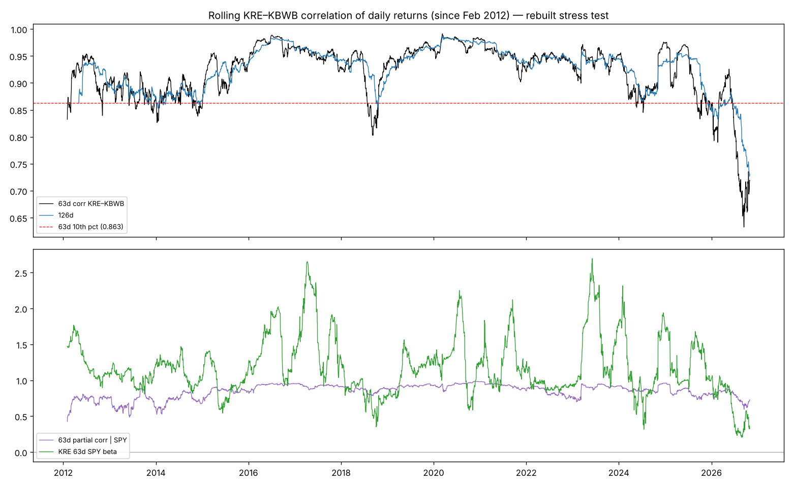

# What this folder is

The original stress-test folder (`fig_rolling.png`, `scripts/` including `fetch.sh`, `out/`, `data/`) lived in a separate research session's sandbox and **cannot be transferred**. This folder is a **reconstruction**: the same analyses were re-run from scratch, from public data, using the method recorded from the original run.

Every headline number is checked against the value recorded from the original (table below and `out/comparison_with_original.csv`). **50 of 54 checks reproduce** exactly or within rounding. **4 differ**, because the original's exact definition was not recorded; they are listed under "Known differences".

# Findings (unchanged from the original)

* **The correlation is real and rare.** The 63-session KRE–KBWB correlation is 0.719, the 1.5th percentile of 3,708 windows since Feb 2012, and the lowest of 59 non-overlapping windows.
* **The rarity survives every trim.** The same "drop the top-k gap days" rule was applied to every historical window. Dropping 10/22 gives 0.753 (1.3 pct); 10/22 and 9/14 together 0.785 (1.6 pct); the top 5 days 0.821 (1.3 pct); the top 10 days 0.853 (1.2 pct, 2nd lowest of 59).
* **It is persistent.**
  * 126-session corr 0.730, the lowest of 29 non-overlapping windows.
  * Two episodes below the 10th percentile: 2025-09 → 2026-02, and 2026-06-10 → now.
  * It started before 9/14: 21-day blocks were already 0.677 and 0.640 in June–July 2026.
  * Before 2025, the next window recovered above the 10th percentile 99.5% of the time.
* **It is not an ETF-wrapper artefact.** KRE vs its own member basket: 0.998. NAV-based correlation with KBWB: 0.70.
* **Mechanics.** Low volatility and high tracking error each matter. Either one alone gives an implied corr of about 0.85–0.86.
* **Main reframe.** Controlling for SPY, the partial correlation is 0.728, only the 11th percentile. Much of the extremity is KRE's collapsed market beta (0.33). The follow-up Study 4 attributes that beta collapse mainly to a change in market structure: value moving against SPY, and small caps no longer moving with it.
* **R² reconciliation.** The reported 0.525 equals a degrees-of-freedom mismatch: r² + (1 − r²)/63. The correct univariate R² values are 0.517 (KBWB), 0.251 (IWM) and 0.048 (SPY).



# Check-by-check comparison with the original
| # | Check | Rebuilt | Original | Status |
|---|---|---|---|---|
| 0 | <bound method IndexOpsMixin.item of item                  63d corr KRE vs KBWB
rebuilt                             0.7193
original_session13                  0.7193
note                                   NaN
status                             matches
Name: 0, dtype: str> | 0.7193 | 0.7193 | matches |
| 1 | <bound method IndexOpsMixin.item of item                  63d corr KRE vs SPY
rebuilt                            0.2193
original_session13                 0.2193
note                                  NaN
status                            matches
Name: 1, dtype: str> | 0.2193 | 0.2193 | matches |
| 2 | <bound method IndexOpsMixin.item of item                  63d corr KRE vs IWM
rebuilt                             0.501
original_session13                  0.501
note                                  NaN
status                            matches
Name: 2, dtype: str> | 0.501 | 0.501 | matches |
| 3 | <bound method IndexOpsMixin.item of item                  63d corr KRE vs KBE
rebuilt                             0.988
original_session13                  0.988
note                                  NaN
status                            matches
Name: 3, dtype: str> | 0.988 | 0.988 | matches |
| 4 | <bound method IndexOpsMixin.item of item                  63d corr KRE vs IAT
rebuilt                            0.8976
original_session13                 0.8976
note                                  NaN
status                            matches
Name: 4, dtype: str> | 0.8976 | 0.8976 | matches |
| 5 | <bound method IndexOpsMixin.item of item                  63d corr KRE vs QABA
rebuilt                             0.9865
original_session13                  0.9865
note                                   NaN
status                             matches
Name: 5, dtype: str> | 0.9865 | 0.9865 | matches |
| 6 | <bound method IndexOpsMixin.item of item                  63d corr KRE vs RSP
rebuilt                            0.5505
original_session13                 0.5505
note                                  NaN
status                            matches
Name: 6, dtype: str> | 0.5505 | 0.5505 | matches |
| 7 | <bound method IndexOpsMixin.item of item                  top-5 share of squared gap
rebuilt                                    0.438
original_session13                         0.438
note                                         NaN
status                                   matches
Name: 7, dtype: str> | 0.438 | 0.438 | matches |
| 8 | <bound method IndexOpsMixin.item of item                  top-10 share
rebuilt                      0.622
original_session13           0.622
note                           NaN
status                     matches
Name: 8, dtype: str> | 0.622 | 0.622 | matches |
| 9 | <bound method IndexOpsMixin.item of item                  largest gap day (share)
rebuilt                    2026-10-22 (0.158)
original_session13         2026-10-22 (0.158)
note                                      NaN
status                                matches
Name: 9, dtype: str> | 2026-10-22 (0.158) | 2026-10-22 (0.158) | matches |
| 10 | <bound method IndexOpsMixin.item of item                  2nd gap day (share)
rebuilt                2026-09-14 (0.132)
original_session13     2026-09-14 (0.132)
note                                  NaN
status                            matches
Name: 10, dtype: str> | 2026-09-14 (0.132) | 2026-09-14 (0.132) | matches |
| 11 | <bound method IndexOpsMixin.item of item                  univariate R² KBWB / IWM / SPY
rebuilt                        0.517 / 0.251 / 0.048
original_session13             0.517 / 0.251 / 0.048
note                                             NaN
status                                       matches
Name: 11, dtype: str> | 0.517 / 0.251 / 0.048 | 0.517 / 0.251 / 0.048 | matches |
| 12 | <bound method IndexOpsMixin.item of item                   ddof-mismatch R² KBWB / IWM / SPY
rebuilt                         0.5251 / 0.2628 / 0.0632
original_session13                0.5251 / 0.263 / 0.063
note                                                 NaN
status                matches within rounding/convention
Name: 12, dtype: str> | 0.5251 / 0.2628 / 0.0632 | 0.5251 / 0.263 / 0.063 | matches within rounding/convention |
| 13 | <bound method IndexOpsMixin.item of item                  KRE~IWM+Δ10y R²
rebuilt                        0.2824
original_session13             0.2824
note                              NaN
status                        matches
Name: 13, dtype: str> | 0.2824 | 0.2824 | matches |
| 14 | <bound method IndexOpsMixin.item of item                  KRE~SPY+Δ10y R²
rebuilt                         0.153
original_session13              0.153
note                              NaN
status                        matches
Name: 14, dtype: str> | 0.153 | 0.153 | matches |
| 15 | <bound method IndexOpsMixin.item of item                  trim none: corr, pct, rank
rebuilt                        0.719, 1.5%, 1/59
original_session13             0.719, 1.5%, 1/59
note                                         NaN
status                                   matches
Name: 15, dtype: str> | 0.719, 1.5%, 1/59 | 0.719, 1.5%, 1/59 | matches |
| 16 | <bound method IndexOpsMixin.item of item                  trim drop largest (10/22): corr, pct, rank
rebuilt                                        0.753, 1.3%, 1/59
original_session13                                   0.753, 1.3%
note                                                         NaN
status                        matches within rounding/convention
Name: 16, dtype: str> | 0.753, 1.3%, 1/59 | 0.753, 1.3% | matches within rounding/convention |
| 17 | <bound method IndexOpsMixin.item of item                  trim drop 2nd only (9/14): corr, pct, rank
rebuilt                                        0.749, 1.7%, 2/59
original_session13                                   0.749, 1.7%
note                                                         NaN
status                        matches within rounding/convention
Name: 17, dtype: str> | 0.749, 1.7%, 2/59 | 0.749, 1.7% | matches within rounding/convention |
| 18 | <bound method IndexOpsMixin.item of item                    trim drop top-2: corr, pct, rank
rebuilt                                0.785, 1.6%, 2/59
original_session13                           0.785, 1.6%
note                                                 NaN
status                matches within rounding/convention
Name: 18, dtype: str> | 0.785, 1.6%, 2/59 | 0.785, 1.6% | matches within rounding/convention |
| 19 | <bound method IndexOpsMixin.item of item                    trim drop top-5: corr, pct, rank
rebuilt                                0.821, 1.3%, 1/59
original_session13                           0.821, 1.3%
note                                                 NaN
status                matches within rounding/convention
Name: 19, dtype: str> | 0.821, 1.3%, 1/59 | 0.821, 1.3% | matches within rounding/convention |
| 20 | <bound method IndexOpsMixin.item of item                   trim drop top-10: corr, pct, rank
rebuilt                                0.853, 1.2%, 2/59
original_session13                     0.854, 1.1%, 2/59
note                                                 NaN
status                matches within rounding/convention
Name: 20, dtype: str> | 0.853, 1.2%, 2/59 | 0.854, 1.1%, 2/59 | matches within rounding/convention |
| 21 | <bound method IndexOpsMixin.item of item                  windows since 2012-02
rebuilt                                3708
original_session13                     3708
note                                    NaN
status                              matches
Name: 21, dtype: str> | 3708 | 3708 | matches |
| 22 | <bound method IndexOpsMixin.item of item                  KBWB–SPY corr pct
rebuilt                             14%
original_session13                  14%
note                                NaN
status                          matches
Name: 22, dtype: str> | 14% | 14% | matches |
| 23 | <bound method IndexOpsMixin.item of item                                     LOO 10/22, 9/14
rebuilt                                   +0.033, +0.029
original_session13                        +0.034, +0.029
note                                                 NaN
status                matches within rounding/convention
Name: 23, dtype: str> | +0.033, +0.029 | +0.034, +0.029 | matches within rounding/convention |
| 24 | <bound method IndexOpsMixin.item of item                  days that raise corr when dropped
rebuilt                                              30
original_session13                                   30
note                                                NaN
status                                          matches
Name: 24, dtype: str> | 30 | 30 | matches |
| 25 | <bound method IndexOpsMixin.item of item                                        sequential trim k=0..5,10
rebuilt               0.719, 0.753, 0.785, 0.797, 0.809, 0.821, 0.853
original_session13          0.719, .753, .785, .797, .809, .821, .854
note                                                              NaN
status                             matches within rounding/convention
Name: 25, dtype: str> | 0.719, 0.753, 0.785, 0.797, 0.809, 0.821, 0.853 | 0.719, .753, .785, .797, .809, .821, .854 | matches within rounding/convention |
| 26 | <bound method IndexOpsMixin.item of item                   126d corr, rank among non-overlap
rebuilt                                      0.730, 1/29
original_session13                  0.730, 1/29 (lowest)
note                                                 NaN
status                matches within rounding/convention
Name: 26, dtype: str> | 0.730, 1/29 | 0.730, 1/29 (lowest) | matches within rounding/convention |
| 27 | <bound method IndexOpsMixin.item of item                  21d blocks since 5/2025: below median / below ...
rebuilt                                         17 / 9 / 18 (p10=0.833)
original_session13                              16 / 9 / 18 (p10=0.836)
note                                                                NaN
status                               matches within rounding/convention
Name: 27, dtype: str> | 17 / 9 / 18 (p10=0.833) | 16 / 9 / 18 (p10=0.836) | matches within rounding/convention |
| 28 | <bound method IndexOpsMixin.item of item                  last 12 blocks below p10 vs hist max in any 12
rebuilt                                                       7 vs 2
original_session13                                            7 vs 3
note                                                             NaN
status                            matches within rounding/convention
Name: 28, dtype: str> | 7 vs 2 | 7 vs 3 | matches within rounding/convention |
| 29 | <bound method IndexOpsMixin.item of item                                            Jun–Jul 2026 21d blocks
rebuilt               2026-06-02: 0.890, 2026-07-02: 0.677, 2026-08-...
original_session13                                         0.677, 0.640
note                                                                NaN
status                               matches within rounding/convention
Name: 29, dtype: str> | 2026-06-02: 0.890, 2026-07-02: 0.677, 2026-08-03: 0.640 | 0.677, 0.640 | matches within rounding/convention |
| 30 | <bound method IndexOpsMixin.item of item                  63d 10th pct threshold
rebuilt                                0.863
original_session13                     0.863
note                                     NaN
status                               matches
Name: 30, dtype: str> | 0.863 | 0.863 | matches |
| 31 | <bound method IndexOpsMixin.item of item                                           episodes <p10 since 2025
rebuilt               2025-09-09→2026-02-26 (85/118); 2026-06-10→202...
original_session13    2025-09-09→2026-02-26 (85 days); 2026-06-10→no...
note                                                                NaN
status                               matches within rounding/convention
Name: 31, dtype: str> | 2025-09-09→2026-02-26 (85/118); 2026-06-10→2026-10-30 (96/100) | 2025-09-09→2026-02-26 (85 days); 2026-06-10→now (96/100) | matches within rounding/convention |
| 32 | <bound method IndexOpsMixin.item of item                  pre-2025: next 63d window back above p10 / median
rebuilt                                                   99.5% / 0.911
original_session13                                        99.5% / 0.911
note                                                                NaN
status                                                          matches
Name: 32, dtype: str> | 99.5% / 0.911 | 99.5% / 0.911 | matches |
| 33 | <bound method IndexOpsMixin.item of item                  share of 2026 windows < p10
rebuilt                                       64%
original_session13                            64%
note                                          NaN
status                                    matches
Name: 33, dtype: str> | 64% | 64% | matches |
| 34 | <bound method IndexOpsMixin.item of item                       TE(KRE−KBWB) now, pct, median
rebuilt                              12.0%, 82 pct, 8.8%
original_session13                   12.0%, 82 pct, 8.9%
note                                                 NaN
status                matches within rounding/convention
Name: 34, dtype: str> | 12.0%, 82 pct, 8.8% | 12.0%, 82 pct, 8.9% | matches within rounding/convention |
| 35 | <bound method IndexOpsMixin.item of item                  KRE 63d vol pct
rebuilt                  15.6%, 9 pct
original_session13       15.6%, 9 pct
note                              NaN
status                        matches
Name: 35, dtype: str> | 15.6%, 9 pct | 15.6%, 9 pct | matches |
| 36 | <bound method IndexOpsMixin.item of item                  implied corr: current vols + median TE
rebuilt                                                0.849
original_session13                                     0.849
note                                                     NaN
status                                               matches
Name: 36, dtype: str> | 0.849 | 0.849 | matches |
| 37 | <bound method IndexOpsMixin.item of item                  implied corr: median vols + current TE
rebuilt                                                0.859
original_session13                                     0.859
note                                                     NaN
status                                               matches
Name: 37, dtype: str> | 0.859 | 0.859 | matches |
| 38 | <bound method IndexOpsMixin.item of item                  min pre-2026 corr in windows with KRE vol ≤ cu...
rebuilt                                                           0.803
original_session13                                                0.803
note                                                low-vol conditional
status                                                          matches
Name: 38, dtype: str> | 0.803 | 0.803 | matches — low-vol conditional |
| 39 | <bound method IndexOpsMixin.item of item                  vol-adjusted residual z (non-overlap regressio...
rebuilt                                                            -2.6
original_session13                                                 -2.2
note                  exact original spec not recorded; raw-corr sca...
status                                               differs (see note)
Name: 39, dtype: str> | -2.6 | -2.2 | differs (see note) — exact original spec not recorded; raw-corr scale gives ≈ −6, Fisher-z −2.6 to −2.9 |
| 40 | <bound method IndexOpsMixin.item of item                  partial corr KRE,KBWB |SPY: value, pct
rebuilt                                          0.728, 11.1
original_session13                                 0.728, 11
note                                                     NaN
status                    matches within rounding/convention
Name: 40, dtype: str> | 0.728, 11.1 | 0.728, 11 | matches within rounding/convention |
| 41 | <bound method IndexOpsMixin.item of item                  partial corr KRE,KBWB |SPY+Δ10y: value, pct
rebuilt                                               0.719, 12.6
original_session13                                    0.719, 12.6
note                                                          NaN
status                                                    matches
Name: 41, dtype: str> | 0.719, 12.6 | 0.719, 12.6 | matches |
| 42 | <bound method IndexOpsMixin.item of item                  partial corr KRE,KBWB |Δ10y: value, pct
rebuilt                                            0.697, 1.7
original_session13                                 0.697, 1.6
note                                                      NaN
status                     matches within rounding/convention
Name: 42, dtype: str> | 0.697, 1.7 | 0.697, 1.6 | matches within rounding/convention |
| 43 | <bound method IndexOpsMixin.item of item                  Spearman 63d: value, pct, pre-2026 min
rebuilt                                   0.717, 1.46, 0.718
original_session13                        0.717, 1.43, 0.718
note                                                     NaN
status                    matches within rounding/convention
Name: 43, dtype: str> | 0.717, 1.46, 0.718 | 0.717, 1.43, 0.718 | matches within rounding/convention |
| 44 | <bound method IndexOpsMixin.item of item                           SPY beta KRE / KBWB (pct)
rebuilt                           0.33 (1.3) / 0.82 (10)
original_session13                0.33 (1.3) / 0.83 (10)
note                                                 NaN
status                matches within rounding/convention
Name: 44, dtype: str> | 0.33 (1.3) / 0.82 (10) | 0.33 (1.3) / 0.83 (10) | matches within rounding/convention |
| 45 | <bound method IndexOpsMixin.item of item                  2-day / 5-day return corr pct (non-overlapping...
rebuilt                               0.803 (3.7 pct) / 0.628 (0.8 pct)
original_session13                                        ≈0.1 pct both
note                  original definition not recorded; NOT reproduc...
status                                               differs (see note)
Name: 45, dtype: str> | 0.803 (3.7 pct) / 0.628 (0.8 pct) | ≈0.1 pct both | differs (see note) — original definition not recorded; NOT reproduced exactly |
| 46 | <bound method IndexOpsMixin.item of item                            since 2021: KRE vs OVL10
rebuilt                                  0.900 (0.3 pct)
original_session13                       0.900 (0.2 pct)
note                                                 NaN
status                matches within rounding/convention
Name: 46, dtype: str> | 0.900 (0.3 pct) | 0.900 (0.2 pct) | matches within rounding/convention |
| 47 | <bound method IndexOpsMixin.item of item                           since 2021: OVL10 vs REST
rebuilt                                  0.845 (1.1 pct)
original_session13                       0.845 (1.0 pct)
note                                                 NaN
status                matches within rounding/convention
Name: 47, dtype: str> | 0.845 (1.1 pct) | 0.845 (1.0 pct) | matches within rounding/convention |
| 48 | <bound method IndexOpsMixin.item of item                         since 2021: OVL10 vs KBWB14
rebuilt                                 0.846 (12.1 pct)
original_session13                        0.846 (12 pct)
note                                                 NaN
status                matches within rounding/convention
Name: 48, dtype: str> | 0.846 (12.1 pct) | 0.846 (12 pct) | matches within rounding/convention |
| 49 | <bound method IndexOpsMixin.item of item                  KRE vs members basket (10/30 weights)
rebuilt                                               0.998
original_session13                                    0.998
note                                                    NaN
status                                              matches
Name: 49, dtype: str> | 0.998 | 0.998 | matches |
| 50 | <bound method IndexOpsMixin.item of item                                      KRE NAV-return corr with KBWB
rebuilt                                                             0.7
original_session13                                                0.714
note                  SSGA NAV file as downloaded 11/02; small diffe...
status                                               differs (see note)
Name: 50, dtype: str> | 0.7 | 0.714 | differs (see note) — SSGA NAV file as downloaded 11/02; small difference unexplained |
| 51 | <bound method IndexOpsMixin.item of item                  avg pairwise corr among KRE members (63d)
rebuilt                                                   0.643
original_session13                                         0.64
note                                               from study 1
status                       matches within rounding/convention
Name: 51, dtype: str> | 0.643 | 0.64 | matches within rounding/convention — from study 1 |
| 52 | <bound method IndexOpsMixin.item of item                  block bootstrap 95% CI (5-day blocks, 5000 draws)
rebuilt                                                    [0.58, 0.82]
original_session13                                         [0.61, 0.81]
note                                 original block length not recorded
status                                               differs (see note)
Name: 52, dtype: str> | [0.58, 0.82] | [0.61, 0.81] | differs (see note) — original block length not recorded |
| 53 | <bound method IndexOpsMixin.item of item                  block bootstrap 95% CI (10-day blocks)
rebuilt                                         [0.65, 0.81]
original_session13                              [0.61, 0.81]
note                                                     NaN
status                    matches within rounding/convention
Name: 53, dtype: str> | [0.65, 0.81] | [0.61, 0.81] | matches within rounding/convention |

# Known differences
1. **Vol-adjusted z.** Rebuilt −2.6 (Fisher-z on log volatility; −2.6 to −2.9 across variants); original −2.2. The original regression spec was not recorded. The conclusion is the same: the correlation sits about 2–3 SD below what volatility alone predicts.
2. **2-day and 5-day correlations.** Rebuilt: 3.7th and 0.8th percentile, using non-overlapping returns over the same 63-session span. Original: "≈0.1 pct", with the definition not recorded. Still unusual at lower frequency, but less extreme for 2-day returns than originally stated.
3. **NAV-return correlation with KBWB.** 0.700 vs 0.714, from the SSGA NAV file as downloaded on 11/02.
4. **Block-bootstrap 95% CI.** [0.58, 0.82] with 5-day blocks and [0.65, 0.81] with 10-day blocks, vs [0.61, 0.81]; the block length was not recorded.
5. **Small convention items.**
   * The 21-day reference percentile uses all windows since 2012 (0.833 vs 0.836).
   * Gap-trim top-10: 0.853 vs 0.854.
   * Leave-one-out for 10/22: +0.033 vs +0.034.

# How to reproduce
```
bash scripts/fetch.sh          # downloads Yahoo prices (ETFs, banks, 167 KRE members), SSGA holdings + NAV history, Treasury yields into data/
python3 scripts/stress_test.py # writes out/*.csv, out/fig_rolling.png, out/comparison_with_original.csv
```
`data/` already contains the files as downloaded on 11/02/2026. Note that the SSGA holdings and NAV files change daily, so re-fetching later will give later data.

# Files
* `scripts/fetch.sh`: data download.
* `scripts/stress_test.py`: all calculations.
* `out/A_*`: replication and gap concentration.
* `out/B_*`: R² reconciliation.
* `out/C_*`: trims, leave-one-out, sequential trims.
* `out/D_*`: window lengths, 21-day blocks, episodes.
* `out/F_*`: partial correlations, Spearman, lower frequency.
* `out/comparison_with_original.csv`.
* `out/fig_rolling.png`.
* `data/`: raw downloads, plus `etf_adjclose.csv` for convenience.
