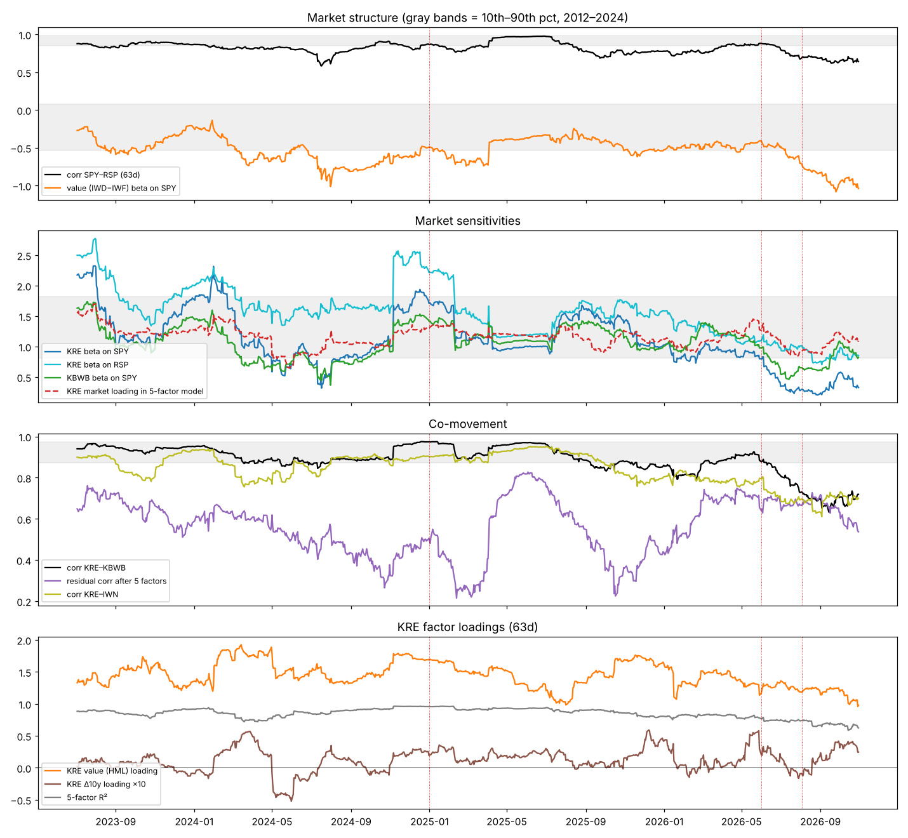

# Answer in one paragraph

**Mostly the market changed, not regional banking.**

* **Why KRE's beta to SPY collapsed (1.13 → 0.33).** Once value, size and momentum factors are added, KRE's own market loading is normal: **1.09, about the 60th percentile.** The low SPY beta comes from a change in how the *factors* move against SPY. Value now has a beta of **−0.85** on SPY, against a pre-2025 median of −0.04. Small caps (SMB) have stopped moving with SPY: their beta is +0.03, against +0.15. Holding KRE's loadings fixed at their 2012–2024 values, that change in market structure accounts for −1.10 of the −0.87 fall in beta. KRE's own loadings moved the *other* way (+0.22).
* **The beta collapse is not specific to regional banks.** All ten comparison ETFs have a 63-session SPY beta at or below their own 10th percentile (0th–9th). They are the seven predetermined nonbank sectors (XLU, IYR, ITB, XLI, XLB, IYT, KIE) plus small value (IWN), financials (XLF) and KBWB.
* **Factor models stopped working market-wide.** Their fit broke down out of sample in Jul–Oct 2026 for KBWB, XLI, XLF and XLB as much as for KRE.
* **The KRE–KBWB correlation fell (0.95 → 0.72) mainly because the shared factor variance halved.** KRE's factor-driven volatility fell from 26.6% to 12.3%, while its residual volatility stayed near normal (9.5% vs 8.3%; 69th percentile). Two smaller pieces remain:
  * **KBWB itself moved toward the mega-cap market.** Its market loading rose from 1.07 to 1.59. That is why its SPY beta held up better than KRE's.
  * **The bank-specific residual correlation between KRE and KBWB is modestly low:** 0.54, at the 14th percentile, or the 24th once volatility is matched. That is the only piece that could reflect regional-bank risk being priced differently, and it is not extreme.
* **Study 3's "rate-beta flip" belongs to the value regime.** The value factor itself now has a record negative yield sensitivity (−0.073, 0th percentile), and small value (IWN, −0.061) matches KRE (−0.062). With style factors controlled, KRE's yield loading is ordinary (34th percentile).

All of this is historical association within one regime, not proof of cause.

---

# 0. Verification of the brief's numbers (rebuilt from raw data)

| Brief | Re-derived (63 sessions to 10/30, univariate, simple daily returns) |
|---|---|
| KRE–KBWB corr 0.719, median ≈0.940 | 0.7193; median since Feb 2012 0.940; 1.5th pct ✓ |
| KRE SPY beta ≈0.33, median ≈1.11 | 0.328; median since Feb 2012 1.105 (1.3th pct); median 2012–2024 1.13 ✓ |
| KBWB SPY beta ≈0.83 | 0.825 (10th pct) ✓ |
| Partial corr given SPY ≈0.728, ~10–11th pct | 0.7276; 11.1th pct ✓ |

**Data**

* **Prices:** Yahoo v8 adjusted closes for 21 ETFs.
* **Factors:** daily Fama-French 3 factors and momentum from the Kenneth French Data Library. The files were built from the CRSP 202609 database, so they **end on 2026-09-30.** For October 2026 (22 sessions) I spliced in ETF proxies:
  * MKT = SPY − RF (correlation with the French series 0.995 over 2013-05 → 2026-09);
  * SMB = IWM − SPY (0.91);
  * HML = IWD − IWF (0.80);
  * MOM = MTUM − SPY (0.68).
* **Robustness to the splice:** every factor result is also shown for the window ending **9/30**, using pure French data. The conclusions are the same.
* **Other series:** Δ10y from the Treasury par curve; ΔBaa from FRED BAA10Y.
* **Reference distributions:** 2012-02 → 2024-12, so 2025–26 is out of sample, unless stated otherwise.
* **Pre-registration:** the spec, hypotheses, model list and ETF set were fixed before any statistic was computed (`SPEC.md`).

---

# 1. Ranked explanations

| Rank | Explanation | What it explains | Key evidence for | Key evidence against |
|---|---|---|---|---|
| **1** | **Market structure / leadership change.** SPY is now driven by mega-cap growth, value trades *against* it, and small caps trade apart from it. | ~All of the SPY-beta collapse; most of the KRE–KBWB correlation drop | Structure term −1.10 vs total −0.87; KRE market loading normal (1.09, 60th pct); corr(SPY, RSP) 0.64 (0th pct); 59% of SPY variance not explained by equal-weight RSP (median 5%); the same collapse in IWN, XLF, KIE, XLB, IYT; vs RSP most sectors are normal; factor fit broke down market-wide | It started in Jan 2025 (SPY–RSP split) and value's negative beta was already deep in mid/late 2024, yet KRE's beta stayed normal until June 2026. Structure alone does not time the onset (see §5). KRE is still lowish against RSP (beta 7th pct) and IWN (corr 4th pct). |
| **2** | **KBWB moved toward the market** (large banks' market loading rose) | Why KBWB's SPY beta fell less (0.82) than KRE's (0.33); part of the KRE–KBWB split | KBWB market loading 1.59 vs 1.07 median (+0.55 to its beta); KBWB market term 1.53 in 2026 H1 | Inference from factor loadings only, not holdings. KBWB's residual volatility and out-of-sample fit deteriorated *more* than KRE's. |
| **3** | **Low-volatility attenuation** | Part of the low *correlations* | Vol-matched windows move KRE–RSP corr to the 25th pct, KRE–IWN to the 21st, partial corr given SPY to the 30th, residual KRE–KBWB corr to the 24th | Does not touch the betas. KRE SPY beta, raw KRE–KBWB corr and 5-factor R² stay at the 0th pct even vol-matched. |
| **4** | **Rate regime** (regionals fall when yields rise) | A small part of fit; links to study 3 | Δ10y adds +0.035 to KRE's out-of-sample R² in Jul–Oct 2026 (historically +0.02); last-21d Δ10y loading at the 3rd pct | It is a **value-factor** property: value (IWD−IWF) yield beta −0.073 (0th pct), IWN −0.061, XLF −0.052, KBWB −0.031. With style controlled, KRE's 63d yield loading is normal (34th pct). |
| **5** | **Regional-bank-specific risk repricing** | At most a modest remainder | Residual KRE–KBWB corr 0.54 (14th pct); KRE–IWN corr 4th pct; last-21d value loading 4th pct; 10/22 behaviour (study 3) | KRE residual vol only 69th pct, *less* elevated than XLI (97), XLF (95), IWN (93), KIE (95). KRE's 63d alpha (−10%) is no worse than KBWB's (−13%). KBWB's factor fit broke down more. Residual corr is 24th pct vol-matched and 29th with pure French data. |

---

# 2. KRE's sensitivities: historical vs recent

### Table 2a — Univariate 63-session correlation and beta against benchmarks (percentile vs 2012–2024)
| Benchmark | KRE corr now | median (pre-2025) | pct | KRE beta now | median | pct | KBWB beta now | median | pct |
|---|---|---|---|---|---|---|---|---|---|
| SPY | 0.22 | 0.68 | 0 | 0.33 | 1.13 | 0 | 0.82 | 1.17 | 9 |
| RSP | 0.55 | 0.76 | 6 | 0.85 | 1.26 | 7 | 0.96 | 1.25 | 10 |
| IWM | 0.50 | 0.79 | 1 | 0.57 | 1.02 | 0 | 0.65 | 0.92 | 11 |
| IWN | 0.70 | 0.86 | 4 | 0.97 | 1.13 | 20 | 0.87 | 0.99 | 23 |
| QQQ | 0.05 | 0.55 | 6 | 0.04 | 0.70 | 5 | 0.28 | 0.72 | 13 |
| XLF | 0.64 | 0.88 | 0 | 0.80 | 1.17 | 1 | 1.07 | 1.19 | 19 |
| KBE | 0.99 | 0.99 | 33 | 1.02 | 1.06 | 31 | 0.83 | 0.95 | 9 |

Reading: KRE is decoupled from **SPY** (0th pct), **QQQ** and **XLF**. Against **equal-weight RSP** it is low (6th–7th pct). Against **small value IWN** its *beta* is normal (0.97, 20th pct), though the correlation is lower (4th pct). Against bank ETFs (KBE) it is normal. KBWB is in the same position against RSP (10th pct) and IWN (23rd pct), and less extreme against SPY.

### Table 2b — KRE five-factor loadings (Mkt, SMB, HML, MOM, Δ10y) over 21/63/126 sessions vs history
Format is "now", then "median · percentile" against rolling windows of the same length from 2012–2024. "Now" ends 10/30 using the spliced factors. The pure-French column ends 9/30.

| 5-factor loading (M3) | 21d now | 21d median · pct | 63d now | 63d median · pct | 63d to 9/30, pure French · pct | 126d now | 126d median · pct |
|---|---|---|---|---|---|---|---|
| Market (Mkt−RF) | 0.90 | 1.03 · 31 | **1.09** | 1.05 · 60 | 1.22 · 84 | 1.02 | 1.05 · 42 |
| Size (SMB) | 0.69 | 0.68 · 52 | **0.66** | 0.68 · 48 | 0.96 · 85 | 0.90 | 0.67 · 79 |
| Value (HML) | 0.60 | 1.25 · 4 | **0.98** | 1.27 · 16 | 1.22 · 43 | 0.98 | 1.30 · 12 |
| Momentum | 0.12 | 0.15 · 47 | **0.12** | 0.13 · 49 | -0.05 · 28 | -0.11 | 0.12 · 23 |
| Δ10y (per 1pp) | -0.05 | 0.03 · 3 | **0.02** | 0.03 · 34 | 0.04 · 59 | 0.04 | 0.04 · 51 |
| R² | 0.73 | 0.90 · 5 | **0.62** | 0.87 · 0 | 0.68 · 2 | 0.63 | 0.85 · 0 |
| Residual vol (ann.) | 8.9% | 6.9% · 78 | **9.5%** | 8.3% · 69 | 9.0% · 64 | 10.9% | 8.6% · 74 |
| Residual corr KRE–KBWB | 0.42 | 0.72 · 10 | **0.54** | 0.72 · 14 | 0.63 · 29 | 0.65 | 0.73 · 30 |

**KRE's factor loadings are ordinary.**

* **Market** loading: 31st–84th pct depending on the window.
* **Size** loading: 48th–85th pct.
* **Value** loading is somewhat low: 12th–16th pct (43rd with pure French data), and 4th pct over the last 21 days.
* **Δ10y** loading is normal over 63 and 126 sessions; it is low only over the last 21 days.

**What is abnormal is the R²** (0th–5th pct), and that happens with **near-normal residual volatility** (64th–78th pct). The residual KRE–KBWB correlation is the 10th–30th pct.

### Table 2c — Explanatory power of each model (KRE, in-sample)
| Model | R² 21d (pct) | R² 63d (pct) | R² 126d (pct) | 63d hist median R² | 63d resid corr KRE–KBWB (pct) |
|---|---|---|---|---|---|
| M0 SPY | 0.00 (0) | 0.05 (0) | 0.05 (0) | 0.46 | 0.73 (11) |
| M1 MKT | 0.00 (0) | 0.05 (0) | 0.06 (0) | 0.50 | 0.72 (14) |
| E1 RSP | 0.48 (32) | 0.30 (6) | 0.31 (2) | 0.57 | 0.58 (3) |
| E2 RSP+CONC | 0.60 (39) | 0.33 (6) | 0.35 (3) | 0.62 | 0.67 (8) |
| M2 FF3+MOM | 0.71 (6) | 0.61 (1) | 0.61 (0) | 0.86 | 0.55 (15) |
| M3 +Δ10y | 0.73 (5) | 0.62 (0) | 0.63 (0) | 0.87 | 0.54 (14) |
| M4 +CONC+ΔBaa | 0.74 (4) | 0.63 (0) | 0.63 (0) | 0.87 | 0.54 (16) |

Adding the style factors raises KRE's 63d R² from 0.05 (SPY only) to 0.61. Rates, the SPY−RSP concentration spread and the Baa spread add almost nothing in sample (0.61 → 0.63). An equal-weight market (RSP) explains 0.30, far more than SPY's 0.05.

---

# 3. Is the market different? (sub-question 1)

### Table 3a — Market-structure metrics
| Market-structure metric (63d) | Now | pre-2025 median | pct | 2025 median | 2026 H1 median |
|---|---|---|---|---|---|
| corr SPY-RSP | 0.64 | 0.97 | 0 | 0.83 | 0.83 |
| share of SPY variance not explained by RSP | 0.59 | 0.05 | 100 | 0.31 | 0.31 |
| corr RSP-QQQ | 0.38 | 0.85 | 2 | 0.65 | 0.69 |
| corr SPY-QQQ | 0.92 | 0.92 | 46 | 0.96 | 0.95 |
| beta RSP~SPY | 0.62 | 0.99 | 0 | 0.81 | 0.76 |
| beta IWN~SPY | 0.62 | 1.08 | 0 | 1.12 | 1.03 |
| beta IWN~RSP | 0.93 | 1.11 | 9 | 1.35 | 1.25 |
| corr value (IWD−IWF)-SPY | -0.66 | -0.25 | 8 | -0.53 | -0.48 |
| vol SPY−RSP (ann.) | 0.09 | 0.03 | 92 | 0.08 | 0.08 |

**What this shows**

* SPY and the equal-weight S&P have come apart. Their correlation is 0.64, the lowest in the 2012–2024 reference, and 59% of SPY's daily variance is now not explained by RSP (the reference median is 5%).
* RSP–QQQ correlation is at the 2nd pct. Value moves against SPY (corr −0.66).
* The split shows up in 2025 (median SPY–RSP corr 0.83) and deepens in late 2026.
* **This is a change in what "the market" means.** An index dominated by mega-cap growth now moves partly independently of, and partly opposite to, value and small-cap stocks.

### Table 3b — How KRE's SPY beta is assembled (63d; beta = Σ loading × factor's beta on SPY + residual)
| Period | KRE SPY beta | = market term | + value term | + size term | + momentum term | + Δ10y term | + residual | KRE market loading | value factor's beta on SPY | size factor's beta on SPY | KBWB SPY beta | KBWB market term |
|---|---|---|---|---|---|---|---|---|---|---|---|---|
| 2012–2024 median | **1.12** | 1.08 | -0.06 | +0.08 | +0.02 | +0.05 | -0.00 | 1.05 | -0.04 | +0.15 | 1.17 | 1.11 |
| 2025 H1 (median) | **1.05** | 1.19 | -0.30 | +0.18 | +0.13 | +0.01 | +0.00 | 1.20 | -0.20 | +0.25 | 1.10 | 1.29 |
| 2025 H2 (median) | **1.40** | 1.16 | -0.22 | +0.34 | +0.05 | +0.00 | +0.00 | 1.14 | -0.17 | +0.44 | 1.24 | 1.21 |
| 2026 H1 (median) | **0.88** | 1.17 | -0.47 | +0.22 | -0.03 | -0.01 | +0.01 | 1.13 | -0.35 | +0.25 | 1.13 | 1.53 |
| Jul–Sep 2026 (median) | **0.29** | 0.93 | -0.56 | +0.00 | -0.13 | -0.02 | +0.03 | 0.94 | -0.46 | +0.00 | 0.63 | 0.94 |
| window ending 10/30/2026 | **0.33** | 1.11 | -0.83 | +0.02 | +0.05 | -0.03 | +0.01 | 1.09 | -0.85 | +0.03 | 0.82 | 1.62 |

**Reading the decomposition**

* KRE's **market term has stayed about 1.1 throughout**, apart from a dip to 0.93 in Jul–Sep 2026.
* The beta fell because the **value term** went from −0.06 to −0.83 and the **size term** went from +0.08 (and +0.2 to +0.34 in 2025) to about 0.
* In 2025 the size and momentum terms offset value's negative co-movement. In mid-2026 small caps stopped co-moving with SPY, and that offset vanished.
* **That is why KRE's beta held up in 2025 despite the SPY–RSP split, and collapsed in June 2026.**
* KBWB faced the same value drag (−0.86), but its market term rose to 1.62.

---

# 4. Is it specific to regional banks? (sub-question 2)

The nonbank set was predetermined: XLU, IYR, ITB (rate-sensitive); XLI, XLB, IYT (cyclical); KIE (non-bank financial). IWN, XLF and KBWB are shown for comparison.

### Table 4 — SPY-beta collapses across sectors (63d; percentile vs 2012–2024)
"Structure" means the change caused by factors' co-movement with SPY, holding the ETF's 2012–24 loadings fixed. "Own loadings" means the change in the ETF's own factor loadings.

| ETF (role) | SPY beta now · pct | % days below p10: 2025 / 2026 | RSP beta now · pct | Δ SPY beta vs 2012–24: total = structure + own loadings | 5-factor R² pct | resid vol pct | OOS R² hist → Jul–Oct 2026 |
|---|---|---|---|---|---|---|---|
| **KRE** (regional banks) | 0.33 · 0 | 0% / 57% | 0.85 · 7 | -0.87 = -1.10 +0.22 | 0 | 69 | 0.85 → 0.46 |
| **KBWB** (large banks) | 0.82 · 9 | 0% / 33% | 0.96 · 10 | -0.40 = -0.96 +0.55 | 0 | 78 | 0.86 → 0.31 |
| **XLF** (financials) | 0.47 · 0 | 32% / 72% | 0.90 · 8 | -0.61 = -0.58 -0.04 | 0 | 95 | 0.91 → 0.37 |
| **KIE** (insurance) | -0.01 · 0 | 34% / 100% | 0.83 · 27 | -0.96 = -0.50 -0.46 | 8 | 95 | 0.81 → 0.37 |
| **IWN** (small value) | 0.62 · 0 | 14% / 40% | 0.93 · 9 | -0.46 = -0.52 +0.07 | 0 | 93 | 0.98 → 0.84 |
| **XLI** (industrials) | 0.82 · 9 | 24% / 8% | 0.88 · 6 | -0.18 = -0.32 +0.13 | 1 | 97 | 0.86 → 0.45 |
| **XLB** (materials) | 0.43 · 0 | 68% / 85% | 0.98 · 19 | -0.58 = -0.31 -0.25 | 0 | 89 | 0.78 → 0.29 |
| **IYT** (transports) | 0.56 · 0 | 23% / 44% | 1.19 · 66 | -0.50 = -0.33 -0.18 | 8 | 83 | 0.75 → 0.41 |
| **ITB** (homebuilders) | 0.58 · 3 | 62% / 12% | 2.08 · 99 | -0.62 = -0.09 -0.53 | 75 | 58 | 0.59 → 0.58 |
| **IYR** (REITs) | 0.27 · 2 | 28% / 72% | 0.87 · 69 | -0.58 = -0.09 -0.48 | 43 | 44 | 0.57 → 0.19 |
| **XLU** (utilities) | 0.05 · 7 | 0% / 35% | 0.57 · 64 | -0.56 = -0.05 -0.50 | 52 | 58 | 0.37 → 0.10 |

**What this shows**

* **SPY-beta collapses below the 10th percentile were common in 2025–26.** XLB was below on 68% of 2025 days and 85% of 2026 days. KIE was below on 100% of 2026. XLF and IYR on 72% of 2026. IYT on 44%, and IWN on 40%.
* **KRE (57% of 2026 days) is in the middle of this group, not an outlier.**
* For the cyclical and value ETFs (IWN, XLF, XLB, IYT, XLI, KIE), most of the fall is **structure**, as it is for KRE.
* For the rate-sensitive ones (XLU, IYR, ITB), it is mostly **own-loading** change: they now behave as bond proxies.
* **Relative to RSP**, most nonbank ETFs look normal (IYR 69th pct, IYT 66th, XLU 64th). KRE (7th), XLF (8th), IWN (9th), KBWB (10th) and XLI (6th) remain lowish. So among assets that load on value and the business cycle, KRE is a typical member, not a unique case.

---

# 5. What remains unexplained? (sub-question 3)

### Table 5a — KRE–KBWB correlation split into common-factor and residual parts (same 5-factor model)
| Period | KRE–KBWB corr | from common factors | from residuals | residual corr | KRE factor vol | KRE resid vol | KBWB factor vol | KBWB resid vol |
|---|---|---|---|---|---|---|---|---|
| ref 2012–2024 (pooled) | 0.95 | 0.83 | 0.12 | 0.76 | 26.6% | 11.5% | 24.8% | 10.2% |
| now 63d to 10/30 (spliced) | 0.72 | 0.52 | 0.19 | 0.54 | 12.3% | 9.5% | 13.3% | 9.6% |
| now 63d to 9/30 (French) | 0.70 | 0.49 | 0.21 | 0.63 | 13.4% | 9.0% | 14.5% | 10.8% |
| 2025 (pooled) | 0.91 | 0.84 | 0.07 | 0.58 | 26.2% | 9.8% | 24.2% | 8.8% |
| 2026 H1 (pooled) | 0.85 | 0.66 | 0.19 | 0.68 | 20.1% | 10.8% | 18.3% | 13.2% |

**What this shows**

* Most of the drop in the KRE–KBWB correlation (0.95 → 0.72) comes from the **common-factor part** (0.83 → 0.52). The factors that both ETFs load on now have much less combined variance, because market and value offset each other: KRE factor volatility is 12% vs 27%.
* The residual contribution actually *rose* (0.12 → 0.19).
* The residual correlation (0.54) is below the pooled reference (0.76). Against rolling windows it is the 14th pct, a modest bank-level split.
* That split was **more pronounced in 2025**: it was below the 10th pct on 56% of 2025 days, but on only 6% of 2026 days.

### Table 5b — Volatility-matched comparison
Reference: the 10% of 2012–2024 windows closest to now in KRE volatility (15.6%) and SPY volatility (10.5%); 325 windows.

| Metric (63d) | Now | pct vs all 2012–24 | pct vs volatility-matched windows | vol-matched median |
|---|---|---|---|---|
| KRE beta SPY | 0.33 | 0 | **0** | 1.02 |
| KRE corr SPY | 0.22 | 0 | **0** | 0.67 |
| KRE corr RSP | 0.55 | 6 | **25** | 0.68 |
| KRE corr IWN | 0.70 | 4 | **21** | 0.79 |
| KRE–KBWB corr | 0.72 | 0 | **0** | 0.89 |
| KRE–KBWB partial|SPY | 0.73 | 11 | **30** | 0.77 |
| M3 R² | 0.62 | 0 | **0** | 0.81 |
| M3 resid corr KRE–KBWB | 0.54 | 14 | **24** | 0.64 |
| E2 R² (RSP+CONC) | 0.33 | 6 | **28** | 0.47 |
| corr SPY–RSP | 0.64 | 0 | **0** | 0.98 |

Matching on volatility moves the *correlation* measures against the broad market, small value and the residual into the 21st–30th percentile, which is unremarkable. It leaves the SPY beta, the raw KRE–KBWB correlation, the factor R² and the SPY–RSP correlation at the extreme.

### Table 5c — Out-of-sample R² (fit on the prior 126 sessions, predict the next non-overlapping 21-session block)
| Asset | Model | 2013-11→2019-12 | 2020–2022 | 2023–2024 | 2025 | 2026 Jan–Jun | 2026 Jul–Oct |
|---|---|---|---|---|---|---|---|
| KRE | M0 SPY | 0.46 | 0.52 | 0.26 | 0.46 | 0.25 | -0.10 |
| KRE | E1 RSP | 0.50 | 0.73 | 0.48 | 0.54 | 0.39 | 0.24 |
| KRE | E2 RSP+CONC | 0.51 | 0.80 | 0.52 | 0.52 | 0.40 | 0.28 |
| KRE | M2 FF3+MOM | 0.78 | 0.89 | 0.80 | 0.85 | 0.76 | 0.43 |
| KRE | M3 +Δ10y | 0.80 | 0.89 | 0.81 | 0.86 | 0.76 | 0.46 |
| KRE | M4 +CONC+ΔBaa | 0.80 | 0.89 | 0.82 | 0.86 | 0.75 | 0.44 |
| KBWB | M0 SPY | 0.58 | 0.61 | 0.33 | 0.67 | 0.42 | 0.16 |
| KBWB | E1 RSP | 0.60 | 0.78 | 0.56 | 0.70 | 0.51 | 0.28 |
| KBWB | E2 RSP+CONC | 0.60 | 0.81 | 0.58 | 0.69 | 0.52 | 0.27 |
| KBWB | M2 FF3+MOM | 0.80 | 0.89 | 0.78 | 0.86 | 0.66 | 0.33 |
| KBWB | M3 +Δ10y | 0.82 | 0.90 | 0.79 | 0.87 | 0.67 | 0.31 |
| KBWB | M4 +CONC+ΔBaa | 0.82 | 0.90 | 0.79 | 0.86 | 0.64 | 0.29 |
| blocks | | 74 | 36 | 24 | 12 | 5 | 5 |

**What this shows**

* **The style factors are the important addition out of sample** (KRE 0.43–0.89, against −0.10 to 0.52 for SPY alone).
* **Δ10y adds a little** (KRE +0.035 in Jul–Oct 2026).
* **The concentration spread (SPY−RSP) and ΔBaa add nothing.**
* **In Jul–Oct 2026 every model's out-of-sample fit fell for KRE *and even more for KBWB*** (0.33 vs 0.46).
* The same breakdown appears in XLI (0.86 → 0.45), XLF (0.91 → 0.37), XLB (0.78 → 0.29) and IYT (0.75 → 0.41) (Table 4).
* This was not cherry-picked: none of these out-of-sample results were used to choose models.

### How much of the unusual behaviour remains

| Unusual feature | Explained by common factors? | What remains |
|---|---|---|
| KRE SPY beta 0.33 vs 1.13 | Yes. Residual term +0.01; KRE's own loadings moved *up* (+0.22). Out-of-sample check, freezing KRE's loadings from one window and applying the next window's factor structure: for the window ending 8/3 it predicted 0.49, against a realized 0.30 and a naive 0.84, so about 65% of the drop was predicted ahead of time. For the window ending 10/30 it predicted −0.10, against a realized 0.33: KRE stayed *more* market-sensitive than structure alone implied. Neither miss points to an extra regional-specific decoupling. | ≈0 |
| KRE–KBWB corr 0.72 vs 0.94 | Mostly: the common-factor part fell 0.83 → 0.52 | Residual corr 0.54: 14th pct (24th vol-matched; 29th pure French) |
| R² 0.62 vs 0.87 | The share explained fell because factor variance shrank | Residual variance is about 1.3× normal. That excess equals **≈9% of KRE's current variance** ((9.5%² − 8.3%²) / 15.6%²) |
| Return path (63d alpha −10%) | No | But KBWB −13%, XLF −6%, IWN −4%: a common drag on value and financials, not KRE-specific |

---

# 6. When did the change occur? (sub-question 4)

### Table 6 — First 10-session run below the 2012–24 10th percentile, and share of days below, by year
| Series (63d) | 2025: first 10-day run below pre-2025 p10 · % days below | 2026: first run · % days below |
|---|---|---|
| corr_SPY_RSP | 2025-01-16 · 60% | 2026-01-02 · 77% |
| HMLp_beta_on_SPY | 2025-01-22 · 32% | 2026-07-09 · 41% |
| HMLff_beta_on_MKTff | — · 5% | 2026-04-22 · 50% |
| corr_QQQ_RSP | 2025-09-08 · 14% | 2026-01-12 · 51% |
| resid_corr_KRE_KBWB_M3 | 2025-01-14 · 56% | — · 6% |
| KRE_corr_KBWB | 2025-09-09 · 25% | 2026-01-02 · 70% |
| KRE_M3_dy10 | — · 6% | 2026-02-05 · 28% |
| KRE_corr_RSP | — · 0% | 2026-03-13 · 48% |
| KRE_beta_SPY | — · 0% | 2026-06-05 · 57% |
| KRE_corr_IWN | — · 0% | 2026-06-05 · 49% |
| KRE_M3_R2 | — · 0% | 2026-06-05 · 53% |
| KBWB_beta_SPY | — · 0% | 2026-06-15 · 33% |
| IWN_beta_SPY | 2025-04-11 · 14% | 2026-07-09 · 40% |
| XLU_beta_SPY | — · 0% | 2026-06-22 · 35% |
| KRE_corr_XLI | — · 0% | 2026-07-01 · 44% |
| KRE_beta_RSP | — · 0% | 2026-08-18 · 22% |
| XLI_beta_SPY | 2025-02-10 · 24% | 2026-09-29 · 8% |

**Sequence (association only)**

1. **Jan 2025 — the market changes first.** SPY decouples from equal-weight (60% of 2025 days below p10), and value moves against SPY (32% of days). KRE's SPY beta stays normal through 2025, because positive size and momentum terms offset the value drag.
2. **2025 — a bank-specific piece appears and fades.** The residual KRE–KBWB split is pronounced from Jan 2025 (56% of days below p10). The raw KRE–KBWB correlation dips from **Sept 2025**, at the same time as an RSP–QQQ correlation break (Sept 2025). That earlier episode coincides with a market-structure shock.
3. **Jan–Mar 2026 — co-movement erodes.** KRE–KBWB correlation below p10 from Jan 2026 (70% of 2026 days); KRE–RSP correlation from March 2026. KRE's Δ10y loading turns low from Feb 2026.
4. **June–July 2026 — a near-simultaneous step.** KRE SPY beta (6/5), KRE–IWN correlation (6/5), KRE factor R² (6/5), KBWB SPY beta (6/15), XLU SPY beta (6/22), KRE–XLI correlation (7/1), IWN SPY beta (7/9) and value's beta on SPY (7/9). Small caps' beta on SPY fell to about 0 in Q3 2026. Several unrelated sectors breaking at the same time points to a **market-wide change in June–July 2026**, not a regional-bank event.
5. **Aug–Oct 2026 — deepening.** KRE's RSP beta goes below p10 (8/18). Value's beta on SPY reaches −0.85 by 10/30.

So the relationships did **not** change together. The market moved first (2025), the bank-specific residual split was strongest in 2025, and the KRE beta collapse came in June 2026 alongside other sectors.

---

# 7. Link to study 3 (rate-beta flip)

### Table 7 — Δ10y sensitivity, controlling for SPY (63d)
| Series | Δ10y beta (63d, controlling SPY) now | pct vs 2012–24 | 2012–24 median | 2026 median |
|---|---|---|---|---|
| Value factor (IWD−IWF) | -0.073 | 0 | +0.014 | -0.031 |
| KRE | -0.062 | 2 | +0.087 | -0.035 |
| KBWB | -0.031 | 3 | +0.074 | -0.002 |
| IWN | -0.061 | 2 | +0.011 | -0.045 |
| XLF | -0.052 | 0 | +0.038 | -0.016 |

The negative rate sensitivity is shared by the value factor (record low) and by small value (IWN) at almost exactly KRE's level. KRE's own yield loading is normal once style factors are in the model (Table 2b). Study 3's flip is best read as "value and small-cap stocks now fall when yields rise," with KRE inheriting it.

---

# 8. Evidence against each explanation (summary)

* **Market structure:**
  * It does not by itself time the June 2026 onset. Value's negative co-movement was deep in mid/late 2024 and 2025 without a KRE beta collapse; the timing needed the size offset to disappear.
  * KRE is still lowish against equal-weight and small value on correlation (6th / 4th pct raw).
  * The ETF proxies for October HML and MOM are imperfect (correlation with French 0.80 / 0.68).
* **KBWB moved:**
  * This is inferred from loadings, not holdings.
  * It cannot explain KRE's own decline against RSP and IWN.
  * KBWB's residual volatility and out-of-sample fit also deteriorated, so "KBWB became a market proxy" is incomplete.
* **Low volatility:**
  * It explains the correlations only partly, and not the betas or R².
* **Rates:**
  * Not regional-specific: value, IWN and XLF share it.
  * Adds only about 0.03 out-of-sample R².
* **Regional-bank repricing:**
  * KRE's residual volatility is normal and less elevated than nonbank cyclicals'.
  * Its factor breakdown is shared.
  * Its alpha is no worse than KBWB's.
  * What supports it: a residual KRE–KBWB correlation at the 14th pct, a last-21-day drop in KRE's value loading (4th pct), and the unique 10/22 behaviour (study 3). These are modest and short-window.

---

# 9. The single most useful next test

**A frozen-loading forecast for the next non-overlapping 63 sessions (11/2/2026 → about 2/2/2027).**

1. **Freeze KRE's current 5-factor loadings:** Mkt 1.09, SMB 0.66, HML 0.98, MOM 0.12, Δ10y 0.024.
2. **At the end of the next window, compute each factor's beta on SPY over that window.** Predict KRE's SPY beta as Σ loading × factor beta.
3. **Compare with the realized beta.**

**Calibration.** On 49 non-overlapping windows from 2012–2024, this forecast's error had a standard deviation of 0.27 (10th / 90th percentiles −0.29 / +0.38). A naive "beta stays the same" forecast had 0.55.

**Decision rule**

* **Market structure:** KRE's SPY beta moves with the prediction, for example recovering if value's and small caps' co-movement with SPY normalizes.
* **Regional-bank-specific repricing:** realized beta falls below the prediction by more than 0.29 while the factor structure normalizes. The same rule applied to KBWB (error sd 0.22) separates "KBWB changed" from "KRE changed".

**Why this one.** It is cheap, reproducible from the scripts here, set before the outcome is known, and it directly tests the claim that the structure terms in Table 3b predicted the beta change. That claim was tested twice. For 5/1 → 8/3 it predicted 0.49 (naive 0.84; realized 0.30), getting most of the drop. For 8/3 → 10/30 it predicted −0.10 against a realized 0.33. That error (+0.43) is beyond the historical 90th percentile, in the direction of KRE being *more* tied to the market than structure implied. So the method is informative but noisy in this regime. That is another reason to pre-register it now rather than fit it after the fact.

---

# 10. Confidence & gaps

* **Confidence:**
  * The beta collapse being market-structural: **medium–high**. The decomposition is an identity given the factors; the out-of-sample timing check passed once; the cross-sector evidence is broad.
  * The correlation drop being mostly factor-variance-driven: **medium.**
  * A modest regional/large-bank residual split existing: **low–medium.** It sits at the 14th–30th pct depending on volatility matching and factor source.
* **Gaps:**
  * French factors end 9/30. October uses proxies, and the HML/MOM proxies are imperfect, although the pure-French 9/30 window gives the same picture.
  * This is association, not causation. "Mega-cap/AI leadership" is my label for the observed SPY-vs-RSP/value split. I did not test what drove that split.
  * The size/value factors are broad: they do not separate "bank" from "value" by construction. A characteristic-matched non-bank portfolio (holdings-level) would be a stronger control, but was not built.
  * KBWB's loading shift is inferred, not decomposed by holdings.
  * Thin out-of-sample samples: 2026 periods have 5 blocks each.
  * The 2025 bank-specific residual episode was not investigated for causes.

# Appendix — Files

| File | Content |
|---|---|
| `SPEC.md` | pre-registered spec + change log |
| `build.py` | builds `data/panel.csv` from Yahoo JSON, French CSVs, study-3 Treasury/BAA master |
| `q124.py` | benchmarks (Q1), sector beta collapses (Q2), rolling series, 21d blocks → `out/q1_*.csv`, `out/q2_sectors.csv`, `out/rolling_63.csv`, `out/blocks21.csv`, `out/onsets.csv` |
| `q3.py` | factor models M0–M4/E1–E2 over 21/63/126 → `out/q3_exposures.csv`, `out/q3_unexplained.csv`, `out/q3_volmatched.csv`, `out/q3_oos*.csv`, `out/q3_rolling63.csv` |
| `q3b.py` | beta and correlation decompositions; sector R²/OOS → `out/q3b_*.csv` |
| `q3c.py` | rate beta of value factor; alphas → `out/q3c_*.csv` |
| `q4.py`, `q4b.py` | timing → `out/q4_*.csv`, `out/q4b_rolling_beta_terms.csv`, `out/fig_timeline.png` |
| `q5_nexttest.py` | frozen-loading test calibration → `out/q5_frozen_loading_test.csv` |
| `make_report.py` | fills `REPORT_template.md` → `REPORT.md` |

**Sources**

* Kenneth R. French Data Library: daily F-F Research Data Factors and Momentum Factor, files built from CRSP 202609 (`https://mba.tuck.dartmouth.edu/pages/faculty/ken.french/ftp/F-F_Research_Data_Factors_daily_CSV.zip`, `…/F-F_Momentum_Factor_daily_CSV.zip`).
* US Treasury daily par yield curve.
* FRED BAA10Y.
* Yahoo Finance chart API: adjusted closes, the only non-primary source, used for ETF prices.
