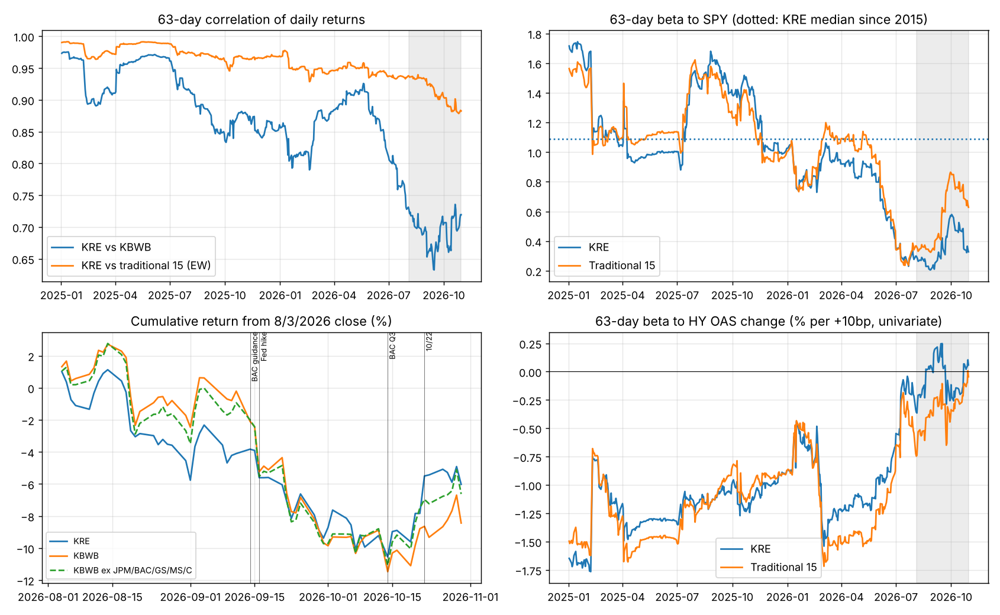

# Study 6 — supplied four-panel chart

Received from Will November 2, 2026. [Original image bytes](study6_four_panel_supplied.png) · [Report](input_report.md) · [Existing review](review.json) · [Provenance](MANIFEST.json)

The image is visually consistent with Study 6's comparisons. The report lists an asset called `fig_study6.png`; the supplied file has a different filename, so that original file identity is not independently established. This is not the three-panel `fig_timeline.png` found in Downloads, and it is not an FLG single-bank chart.

- **Upper left:** KRE's 63-day correlation with KBWB falls much further than its correlation with the equal-weighted traditional-15 bank basket. Comparator composition matters.
- **Upper right:** both KRE and that traditional-bank basket lose sensitivity to SPY during 2026; the traditional-bank basket subsequently recovers more. The dotted line is labeled as KRE's median since 2015.
- **Lower left:** removing JPM/BAC/GS/MS/C makes the displayed KBWB return path much closer to KRE. These are cumulative returns from August 3, not measures of daily correlation. The holdings reconstruction remains unreplicated and the report's additive attribution discrepancy remains unresolved.
- **Lower right:** the displayed univariate sensitivity to high-yield spread changes moves toward zero. There are no uncertainty bands; this does not prove that credit exposure disappeared or that a statistically significant regime change occurred. The units are percent return per +10 basis-point HY OAS change.

The figure improves readability and preserves a previously missing visual. It supplies neither the raw holdings/price/spread inputs nor the figure-generating code. Exact values and causal claims should be taken from reviewed numerical evidence, not estimated from pixels. No live thesis or monitoring authority changes.
